# MVP – Pipeline de Dados na Nuvem para Monitoramento da Meta Atuarial de um RPPS

**Disciplina:** Engenharia de Dados – MVP (PUC-Rio)
**Aluno(a):** Max Gian Martins dos Santos
**Plataforma:** Databricks Free Edition (Unity Catalog, Volumes, Delta Lake, Spark SQL/PySpark)
**Repositório:** [https://github.com/maxgianms-web/mvp-meta-atuarial](https://github.com/maxgianms-web/mvp-meta-atuarial)


## Sumário
1. [Contexto de Negócio e Perguntas (Etapa 2 e 4.1)](#1-contexto-de-negócio-e-perguntas-etapa-2-e-41)
2. [Carga dos Dados (Etapa 4.2)](#2-carga-dos-dados-etapa-42)
3. [Modelagem e Catálogo de Dados (Etapa 4.3)](#3-modelagem-e-catálogo-de-dados-etapa-43)
4. [Pipeline de Dados (Etapa 4.4)](#4-pipeline-de-dados-etapa-44)
5. [Qualidade de Dados (Etapa 4.5)](#5-qualidade-de-dados-etapa-45)
6. [Análise de Dados (Etapa 4.5)](#6-análise-de-dados-etapa-45)
7. [Autoavaliação](#7-autoavaliação)
8. [Como reproduzir](#8-como-reproduzir)
9. [Estrutura do repositório](#9-estrutura-do-repositório)

---

## 1. Contexto de Negócio e Perguntas (Etapa 2 e 4.1)

### 1.1 Problema
Um regime próprio de previdência social (RPPS) precisa que sua carteira de investimentos renda, ao longo do tempo, pelo menos
a **meta atuarial** – o retorno mínimo necessário para honrar os compromissos com os beneficiários. A área de investimentos
acompanha isso manualmente, em planilhas, mês a mês, o que dificulta responder rapidamente: *a carteira está batendo a meta?
Quais classes de ativos sustentam o resultado? O que acontece com a carteira quando os juros ou a bolsa mudam?*

**Objetivo do MVP:** construir, de ponta a ponta e na nuvem, um pipeline de dados (coleta → Bronze → Silver → Gold → análise)
que entregue dados confiáveis e documentados para responder essas perguntas.

### 1.2 Perguntas de negócio
| # | Pergunta | Tabela Gold que responde |
|---|---|---|
| **P1** | A carteira atingiu a meta atuarial? Em quantos meses e no acumulado do período? | `analitico_carteira_mensal` |
| **P2** | Qual classe de ativo mais contribuiu para o resultado financeiro? | `analitico_classe_mensal` |
| **P3** | Existe relação entre a Selic e o retorno dos fundos de renda fixa? | `analitico_classe_mensal` + `fato_mercado` |
| **P4** | Existe relação entre o Ibovespa e o retorno dos fundos de renda variável? | `analitico_classe_mensal` + `fato_mercado` |
| **P5** | Em quais cenários econômicos (juros e bolsa) a carteira supera a meta com mais frequência? | `analitico_carteira_mensal` |

### 1.3 Escopo e premissas
* **Período:** janeiro/2020 a dezembro/2025 (72 meses). **Granularidade:** mensal. **Atualização:** carga em lote (*batch*) mensal.
* **Carteira fictícia:** 12 fundos em 4 classes (Renda Fixa, Renda Variável, Multimercado, Investimentos no Exterior), com
  gestoras e valores inventados. Posições reais de um RPPS são dados sensíveis e não devem ser enviados a ambiente externo
  (orientação do MVP, item 4.2).
* **Mercado real:** Selic, CDI, IPCA e dólar vêm de dados abertos do Banco Central (SGS); o Ibovespa vem do fechamento diário do índice (^BVSP) no Yahoo Finance, coletado pela biblioteca `yfinance`.
* **Meta atuarial (premissa do trabalho):** `IPCA + 5,0% a.a.`, convertida para mensal:
  `meta_mensal = (1 + IPCA_mensal) × (1 + 5%)^(1/12) − 1`. O spread de 5,0% é uma **premissa didática** (parâmetro
  `--spread-aa` do script de coleta); a meta de um RPPS real é definida na sua política de investimentos.
* **Retorno agregado** (carteira ou classe) = `Σ resultado financeiro / Σ posição` (média ponderada pela posição).
* **Cenário econômico:** *juros* = Selic em alta / queda / estável (variação da meta Selic no mês); *bolsa* = Ibovespa em alta
  (variação ≥ 0) ou em queda (< 0).

### 1.4 Dados brutos: origem e estrutura
| Arquivo | Origem | Linhas | Colunas brutas |
|---|---|---|---|
| `mercado.csv` | API SGS do Banco Central (séries 432 Selic meta, 12 CDI diário, 433 IPCA, 1 dólar venda) e Yahoo Finance (Ibovespa, ^BVSP), agregados por mês pelo script `01_baixar_dados_bcb.py` | 72 | `data_referencia, selic, cdi, ipca, ibovespa, dolar, ibovespa_var_pct, dolar_var_pct, selic_var_pp` |
| `meta_atuarial.csv` | Calculada pelo mesmo script a partir do IPCA real (IPCA + 5,0% a.a.) | 72 | `data_referencia, meta_atuarial` |
| `carteira.csv` | **Sintética**, gerada por `02_gerar_carteira_sintetica.py` (semente 42) a partir do mercado real | 870* | `data_referencia, codigo_fundo, nome_fundo, classe_ativo, valor_aplicado, rentabilidade_pct, gestor` |

\* 12 fundos × 72 meses = 864 + 6 linhas duplicadas injetadas de propósito (ver seção 5).

A descrição campo a campo (tipo, domínio, linhagem) está no catálogo da seção 3.

### 1.5 Licença e uso dos dados
* **Dados do Banco Central (SGS):** dados abertos do BCB. O portal de dados abertos do Banco Central indica a licença
  *Open Data Commons Open Database License (ODbL) v1.0*. Fonte: [Taxa de juros - Meta Selic definida pelo Copom](https://dadosabertos.bcb.gov.br/dataset/432-taxa-de-juros---meta-selic-definida-pelo-copom). O IPCA é produzido pelo IBGE e o Ibovespa é um índice da B3; ambos são
  usados aqui apenas para fins acadêmicos.
* **Ibovespa (Yahoo Finance):** os fechamentos foram obtidos pela biblioteca de código aberto `yfinance`, para uso pessoal e acadêmico. Fonte: [Yahoo Terms of Service](https://legal.yahoo.com/us/en/yahoo/terms/otos/index.html). O uso é **exclusivamente** acadêmico
  e o Ibovespa é propriedade da B3 (a B3 também publica a série histórica oficial em sua página de estatísticas históricas do índice).
* **Carteira de fundos:** dados fictícios gerados pelo autor; não há restrição de licença. Não representam nenhum RPPS real.

### 1.6 Premissa metodológica importante
Como a rentabilidade dos fundos sintéticos é construída como função do mercado real mais ruído aleatório
(`02_gerar_carteira_sintetica.py`), **as relações encontradas em P3 e P4 refletem as premissas do gerador**. O MVP demonstra
a *metodologia* e a *engenharia* do pipeline, não descobertas sobre fundos reais. Isso é discutido na seção 6 e na autoavaliação.

---

## 2. Carga dos Dados (Etapa 4.2)

**Estratégia:** *caso simples* das orientações – gerar os arquivos CSV e fazer upload para um **Volume** do Unity Catalog
(`/Volumes/mvp_meta_atuarial/bronze/raw_files`), de onde o notebook de ingestão os lê.

1. No computador local, rodar os scripts (o acesso à API do BCB exige internet):
   * `python scripts/01_baixar_dados_bcb.py` → gera `dados/mercado.csv` e `dados/meta_atuarial.csv`
   * `python scripts/02_gerar_carteira_sintetica.py` → gera `dados/carteira.csv`
2. No Databricks, executar `notebooks/00_setup.py` (cria catálogo, schemas e o Volume `raw_files`).
3. Em **Catalog → mvp_meta_atuarial → bronze → raw_files → Upload to this volume**, enviar os 3 CSVs.
4. Executar `notebooks/01_bronze_ingestion.py`.

**Scripts de coleta no GitHub:** [`scripts/01_baixar_dados_bcb.py`](scripts/01_baixar_dados_bcb.py) e
[`scripts/02_gerar_carteira_sintetica.py`](scripts/02_gerar_carteira_sintetica.py).
O script 01 valida os valores baixados (faixas plausíveis por indicador) antes de gravar os CSVs. A série 7 do SGS (Ibovespa) foi testada e
descartada porque só traz dados até 2019; por isso o índice vem do Yahoo Finance.

**Evidências (screenshots):**

*Coleta dos dados (scripts executados localmente):*

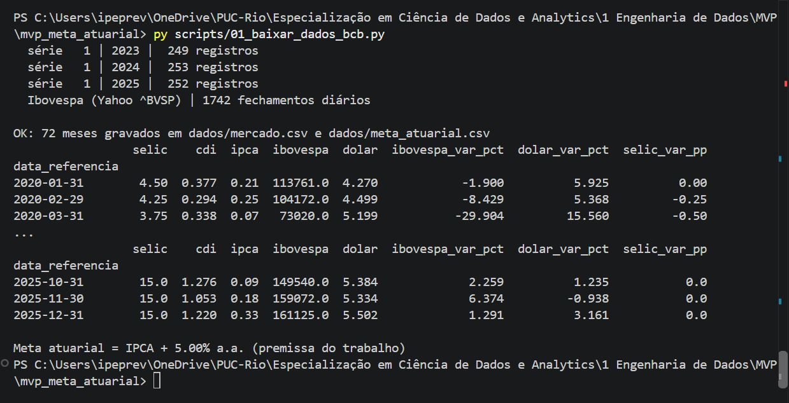
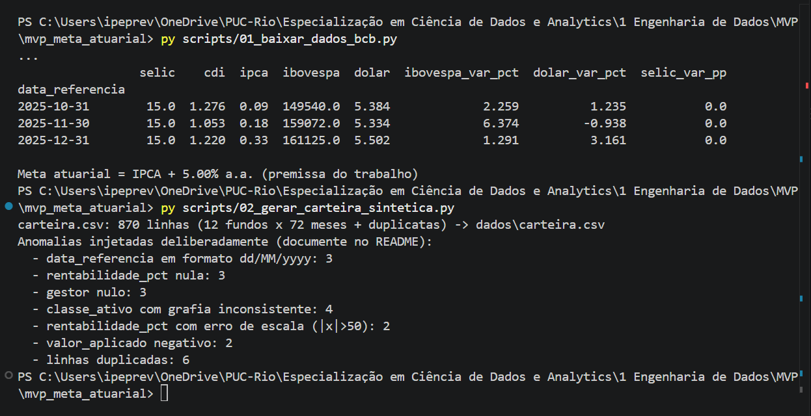

*Ambiente no Databricks e upload dos CSVs:*

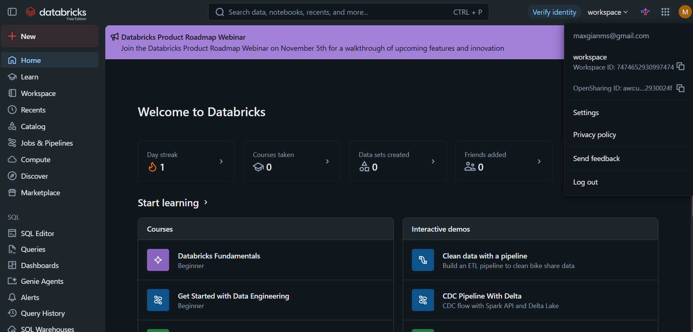
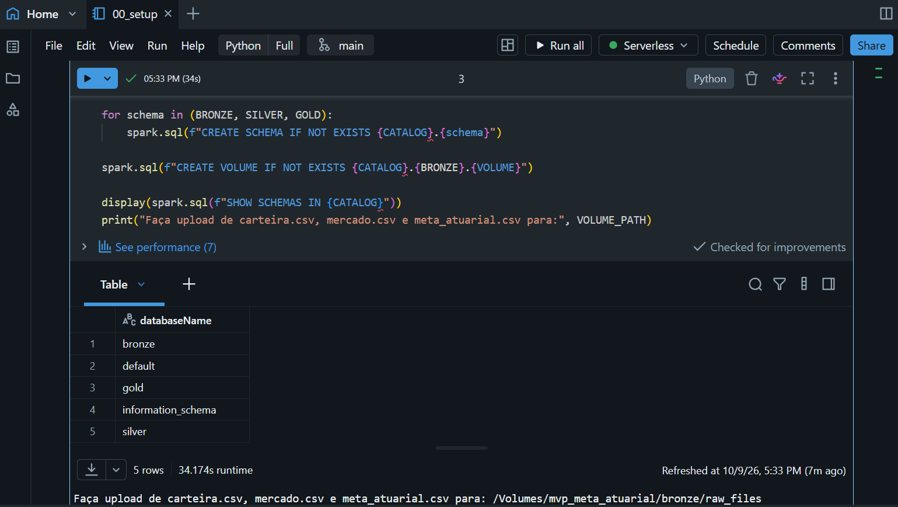
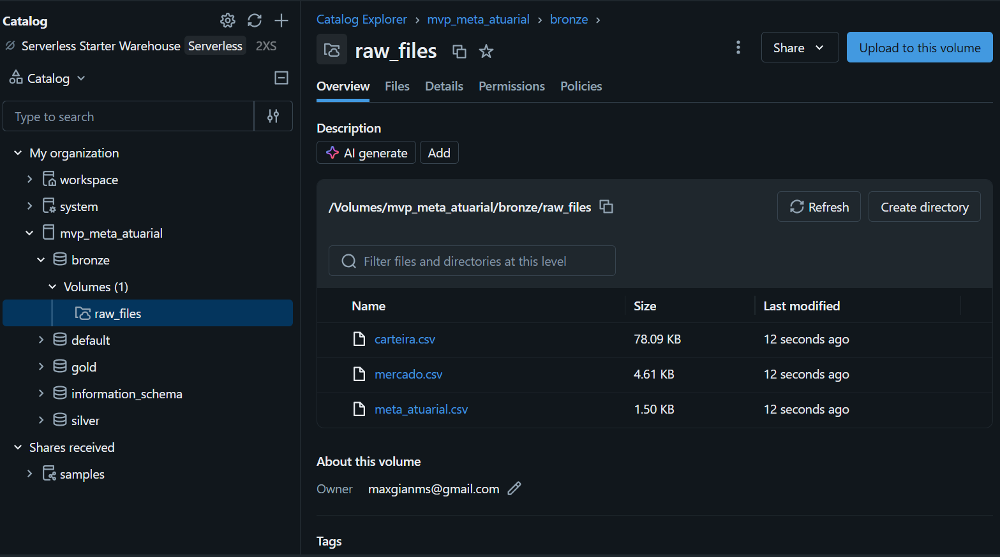

*Ingestão na camada Bronze:*

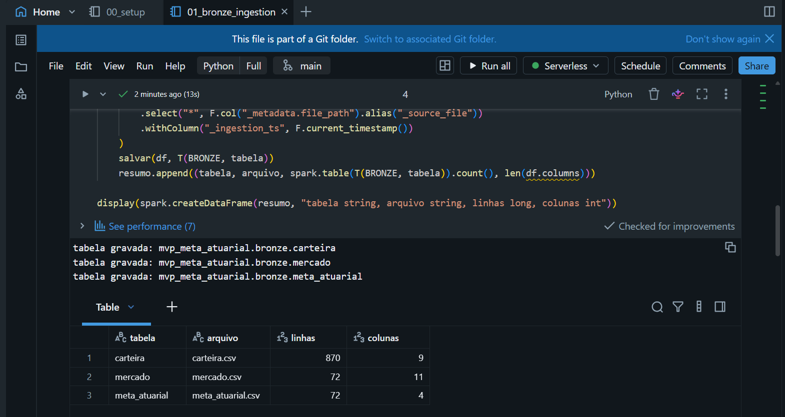

---

## 3. Modelagem e Catálogo de Dados (Etapa 4.3)

### 3.1 Arquitetura Medalhão
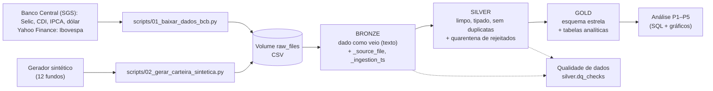

### 3.2 Modelo dimensional (Gold) – Esquema Estrela
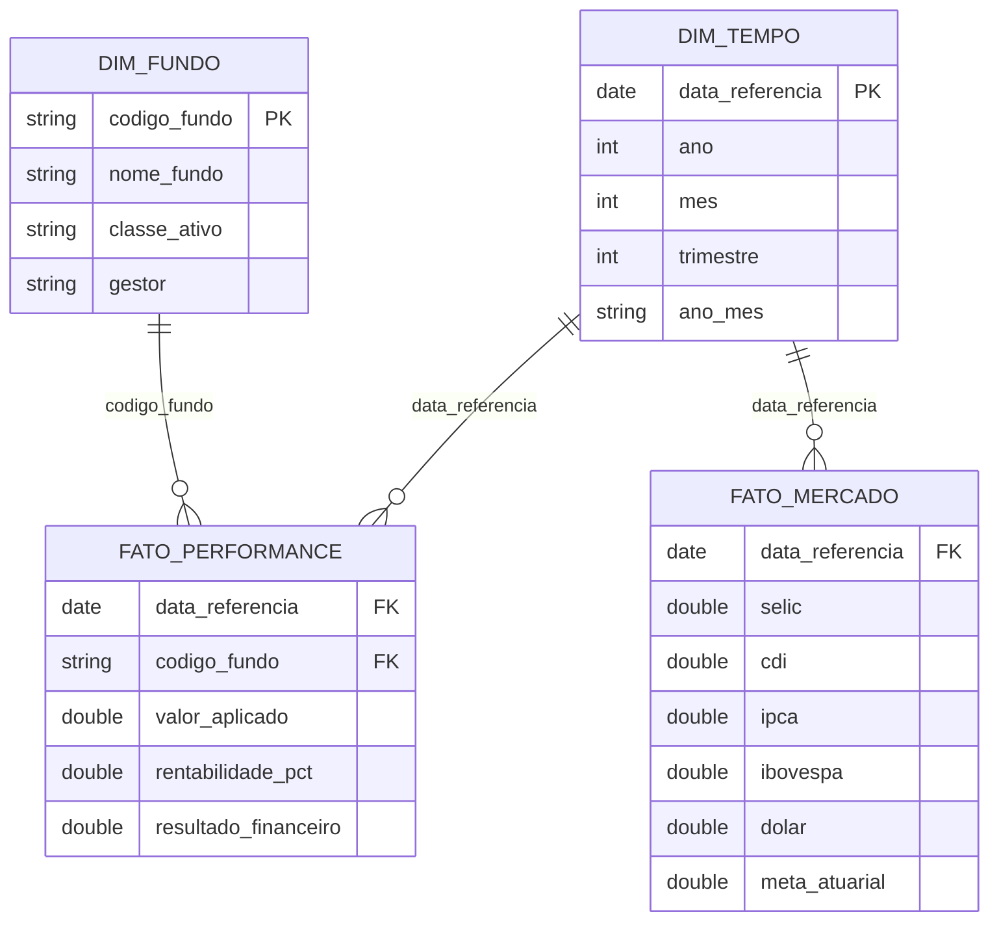
* **Granularidade:** `fato_performance` = fundo × mês; `fato_mercado` = mês.
* **Por que estrela e não *flat*?** As perguntas cruzam o desempenho dos fundos (por classe, por mês) com o mercado (por mês).
  Fatos separados com dimensões compartilhadas evitam repetir o mercado em cada linha de fundo e deixam as consultas simples.
* **Tabelas analíticas** (`analitico_carteira_mensal`, `analitico_classe_mensal`) pré-agregam o que as perguntas P1–P5 consomem.

### 3.3 Catálogo de Dados
O catálogo abaixo descreve **todas as tabelas e colunas** (descrição, tipo, domínio de valores e linhagem). Ele é gerado a partir
de [`notebooks/catalogo.py`](notebooks/catalogo.py) – a mesma fonte usada pelo notebook `05_data_catalog.py` para gravar os
`COMMENT` no **Unity Catalog** – e também está em [`docs/catalogo_dados.md`](docs/catalogo_dados.md).

*Evidências do catálogo no Unity Catalog (Catalog Explorer):*

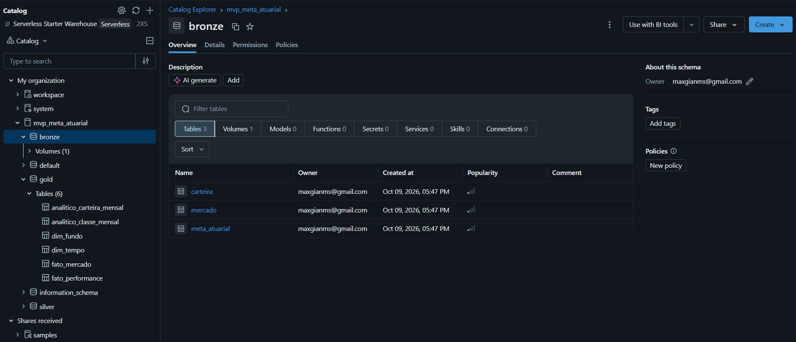
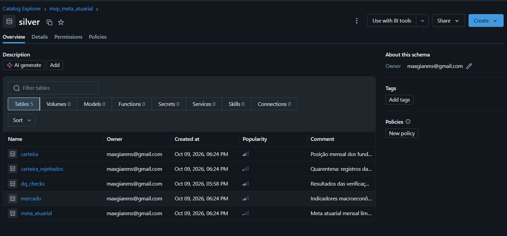
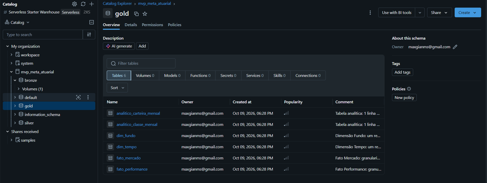

*Aba Overview de uma tabela Gold, com a descrição da tabela e os comentários de cada coluna:*

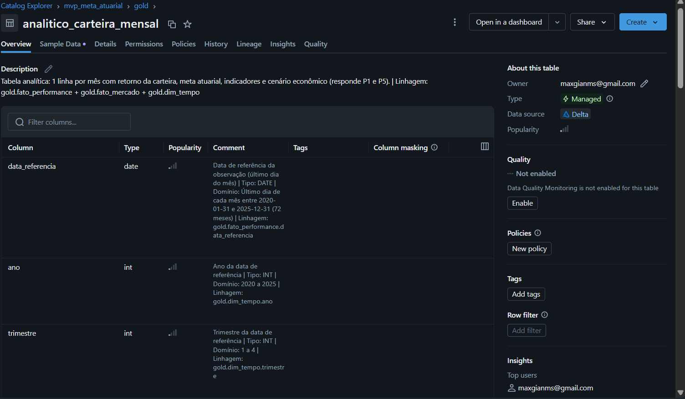

*Aba Lineage de `gold.analitico_carteira_mensal` (de quais tabelas e notebooks ela vem):*

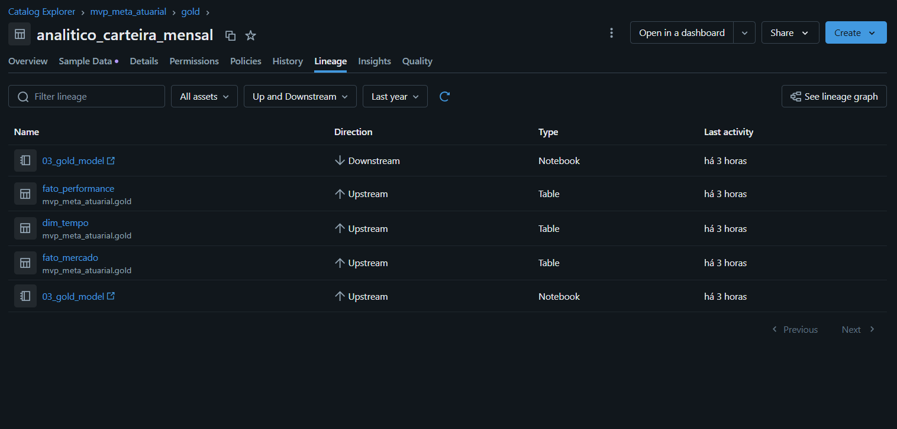

*Resultado da consulta em `information_schema.columns` (notebook `05`), com a mensagem de consistência do catálogo:*

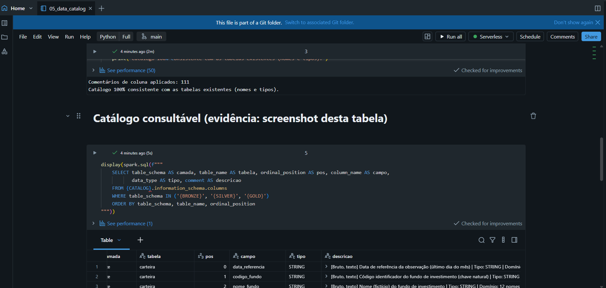


### Camada Bronze (dado bruto)

<details><summary>Expandir catálogo desta camada</summary>

#### `bronze.carteira`

**Descrição:** Posição mensal (sintética) dos 12 fundos da carteira do RPPS, exatamente como recebida do CSV (tudo texto) + metadados de ingestão.

**Linhagem da tabela:** carteira.csv (gerado por scripts/02_gerar_carteira_sintetica.py)

| Campo | Descrição | Tipo | Domínio de valores | Linhagem |
|---|---|---|---|---|
| `data_referencia` | [Bruto, texto] Data de referência da observação (último dia do mês) | STRING | Último dia de cada mês entre 2020-01-31 e 2025-12-31 (72 meses) | Arquivo de origem: carteira.csv (gerado por scripts/02_gerar_carteira_sintetica.py), coluna data_referencia |
| `codigo_fundo` | [Bruto, texto] Código identificador do fundo de investimento (chave natural) | STRING | FND001 a FND012 | Arquivo de origem: carteira.csv (gerado por scripts/02_gerar_carteira_sintetica.py), coluna codigo_fundo |
| `nome_fundo` | [Bruto, texto] Nome (fictício) do fundo de investimento | STRING | 12 nomes distintos, 1 por código | Arquivo de origem: carteira.csv (gerado por scripts/02_gerar_carteira_sintetica.py), coluna nome_fundo |
| `classe_ativo` | [Bruto, texto] Classe de ativo do fundo | STRING | Renda Fixa; Renda Variável; Multimercado; Investimentos no Exterior | Arquivo de origem: carteira.csv (gerado por scripts/02_gerar_carteira_sintetica.py), coluna classe_ativo |
| `valor_aplicado` | [Bruto, texto] Posição do RPPS no fundo no início do mês de referência, em R$ | STRING | Maior que 0 | Arquivo de origem: carteira.csv (gerado por scripts/02_gerar_carteira_sintetica.py), coluna valor_aplicado |
| `rentabilidade_pct` | [Bruto, texto] Rentabilidade do fundo no mês de referência, em % (1,25 = 1,25%) | STRING | Entre -50 e +50 % a.m. (faixa de plausibilidade) | Arquivo de origem: carteira.csv (gerado por scripts/02_gerar_carteira_sintetica.py), coluna rentabilidade_pct |
| `gestor` | [Bruto, texto] Gestora (fictícia) responsável pelo fundo | STRING | Gestora Alfa, Beta, Gama, Delta, Épsilon, Zeta; 'Não informado' quando ausente (Silver) | Arquivo de origem: carteira.csv (gerado por scripts/02_gerar_carteira_sintetica.py), coluna gestor |
| `_source_file` | Caminho do arquivo de origem no Volume (rastreabilidade) | STRING | Caminho em /Volumes/... | Gerado na ingestão (01_bronze_ingestion.py) |
| `_ingestion_ts` | Data/hora da ingestão na camada Bronze | TIMESTAMP | Timestamp UTC da carga | Gerado na ingestão (01_bronze_ingestion.py) |

#### `bronze.mercado`

**Descrição:** Indicadores macroeconômicos mensais reais (Banco Central), como recebidos do CSV (tudo texto) + metadados de ingestão.

**Linhagem da tabela:** mercado.csv (gerado por scripts/01_baixar_dados_bcb.py a partir das séries SGS do Banco Central: 432 Selic meta, 12 CDI, 433 IPCA, 1 dólar; e do fechamento do Ibovespa (^BVSP) obtido do Yahoo Finance)

| Campo | Descrição | Tipo | Domínio de valores | Linhagem |
|---|---|---|---|---|
| `data_referencia` | [Bruto, texto] Data de referência da observação (último dia do mês) | STRING | Último dia de cada mês entre 2020-01-31 e 2025-12-31 (72 meses) | Arquivo de origem: mercado.csv (gerado por scripts/01_baixar_dados_bcb.py a partir das séries SGS do Banco Central: 432 Selic meta, 12 CDI, 433 IPCA, 1 dólar; e do fechamento do Ibovespa (^BVSP) obtido do Yahoo Finance), coluna data_referencia |
| `selic` | [Bruto, texto] Meta Selic vigente no fim do mês, em % ao ano | STRING | Entre 0 e 50 % a.a. | Arquivo de origem: mercado.csv (gerado por scripts/01_baixar_dados_bcb.py a partir das séries SGS do Banco Central: 432 Selic meta, 12 CDI, 433 IPCA, 1 dólar; e do fechamento do Ibovespa (^BVSP) obtido do Yahoo Finance), coluna selic |
| `cdi` | [Bruto, texto] CDI acumulado no mês (taxas diárias compostas), em % ao mês | STRING | Entre 0 e 5 % a.m. | Arquivo de origem: mercado.csv (gerado por scripts/01_baixar_dados_bcb.py a partir das séries SGS do Banco Central: 432 Selic meta, 12 CDI, 433 IPCA, 1 dólar; e do fechamento do Ibovespa (^BVSP) obtido do Yahoo Finance), coluna cdi |
| `ipca` | [Bruto, texto] IPCA - variação mensal, em % ao mês | STRING | Entre -2 e 5 % a.m. | Arquivo de origem: mercado.csv (gerado por scripts/01_baixar_dados_bcb.py a partir das séries SGS do Banco Central: 432 Selic meta, 12 CDI, 433 IPCA, 1 dólar; e do fechamento do Ibovespa (^BVSP) obtido do Yahoo Finance), coluna ipca |
| `ibovespa` | [Bruto, texto] Índice Ibovespa, pontos no último pregão do mês | STRING | Entre 10.000 e 300.000 pontos | Arquivo de origem: mercado.csv (gerado por scripts/01_baixar_dados_bcb.py a partir das séries SGS do Banco Central: 432 Selic meta, 12 CDI, 433 IPCA, 1 dólar; e do fechamento do Ibovespa (^BVSP) obtido do Yahoo Finance), coluna ibovespa |
| `dolar` | [Bruto, texto] Dólar comercial (venda), R$ por US$, no último dia do mês | STRING | Entre 1 e 10 R$/US$ | Arquivo de origem: mercado.csv (gerado por scripts/01_baixar_dados_bcb.py a partir das séries SGS do Banco Central: 432 Selic meta, 12 CDI, 433 IPCA, 1 dólar; e do fechamento do Ibovespa (^BVSP) obtido do Yahoo Finance), coluna dolar |
| `ibovespa_var_pct` | [Bruto, texto] Variação percentual do Ibovespa em relação ao mês anterior | STRING | Entre -50 e +50 % | Arquivo de origem: mercado.csv (gerado por scripts/01_baixar_dados_bcb.py a partir das séries SGS do Banco Central: 432 Selic meta, 12 CDI, 433 IPCA, 1 dólar; e do fechamento do Ibovespa (^BVSP) obtido do Yahoo Finance), coluna ibovespa_var_pct |
| `dolar_var_pct` | [Bruto, texto] Variação percentual do dólar em relação ao mês anterior | STRING | Entre -50 e +50 % | Arquivo de origem: mercado.csv (gerado por scripts/01_baixar_dados_bcb.py a partir das séries SGS do Banco Central: 432 Selic meta, 12 CDI, 433 IPCA, 1 dólar; e do fechamento do Ibovespa (^BVSP) obtido do Yahoo Finance), coluna dolar_var_pct |
| `selic_var_pp` | [Bruto, texto] Variação da Meta Selic em relação ao mês anterior, em pontos percentuais | STRING | Entre -5 e +5 p.p.; 0 = sem mudança | Arquivo de origem: mercado.csv (gerado por scripts/01_baixar_dados_bcb.py a partir das séries SGS do Banco Central: 432 Selic meta, 12 CDI, 433 IPCA, 1 dólar; e do fechamento do Ibovespa (^BVSP) obtido do Yahoo Finance), coluna selic_var_pp |
| `_source_file` | Caminho do arquivo de origem no Volume (rastreabilidade) | STRING | Caminho em /Volumes/... | Gerado na ingestão (01_bronze_ingestion.py) |
| `_ingestion_ts` | Data/hora da ingestão na camada Bronze | TIMESTAMP | Timestamp UTC da carga | Gerado na ingestão (01_bronze_ingestion.py) |

#### `bronze.meta_atuarial`

**Descrição:** Meta atuarial mensal (IPCA + 5,0% a.a.), como recebida do CSV (tudo texto) + metadados de ingestão.

**Linhagem da tabela:** meta_atuarial.csv (gerado por scripts/01_baixar_dados_bcb.py: IPCA real + spread de 5,0% a.a.)

| Campo | Descrição | Tipo | Domínio de valores | Linhagem |
|---|---|---|---|---|
| `data_referencia` | [Bruto, texto] Data de referência da observação (último dia do mês) | STRING | Último dia de cada mês entre 2020-01-31 e 2025-12-31 (72 meses) | Arquivo de origem: meta_atuarial.csv (gerado por scripts/01_baixar_dados_bcb.py: IPCA real + spread de 5,0% a.a.), coluna data_referencia |
| `meta_atuarial` | [Bruto, texto] Meta atuarial mensal = (1+IPCA)*(1+spread)^(1/12)-1, com spread real de 5,0% a.a. (premissa), em % ao mês | STRING | Entre -2 e 5 % a.m. (pode ser levemente negativa em mês de deflação forte) | Arquivo de origem: meta_atuarial.csv (gerado por scripts/01_baixar_dados_bcb.py: IPCA real + spread de 5,0% a.a.), coluna meta_atuarial |
| `_source_file` | Caminho do arquivo de origem no Volume (rastreabilidade) | STRING | Caminho em /Volumes/... | Gerado na ingestão (01_bronze_ingestion.py) |
| `_ingestion_ts` | Data/hora da ingestão na camada Bronze | TIMESTAMP | Timestamp UTC da carga | Gerado na ingestão (01_bronze_ingestion.py) |

</details>

### Camada Silver (dado limpo e padronizado)

<details><summary>Expandir catálogo desta camada</summary>

#### `silver.carteira`

**Descrição:** Posição mensal dos fundos limpa, tipada e padronizada (sem duplicatas; registros inválidos enviados a silver.carteira_rejeitados).

**Linhagem da tabela:** bronze.carteira

| Campo | Descrição | Tipo | Domínio de valores | Linhagem |
|---|---|---|---|---|
| `data_referencia` | Data de referência da observação (último dia do mês) | DATE | Último dia de cada mês entre 2020-01-31 e 2025-12-31 (72 meses) | bronze.carteira.data_referencia (aceita AAAA-MM-DD e DD/MM/AAAA; ajustada ao último dia do mês) |
| `codigo_fundo` | Código identificador do fundo de investimento (chave natural) | STRING | FND001 a FND012 | bronze.carteira.codigo_fundo |
| `nome_fundo` | Nome (fictício) do fundo de investimento | STRING | 12 nomes distintos, 1 por código | bronze.carteira.nome_fundo |
| `classe_ativo` | Classe de ativo do fundo | STRING | Renda Fixa; Renda Variável; Multimercado; Investimentos no Exterior | bronze.carteira.classe_ativo (trim + mapeamento para a grafia canônica) |
| `valor_aplicado` | Posição do RPPS no fundo no início do mês de referência, em R$ | DOUBLE | Maior que 0 | bronze.carteira.valor_aplicado |
| `rentabilidade_pct` | Rentabilidade do fundo no mês de referência, em % (1,25 = 1,25%) | DOUBLE | Entre -50 e +50 % a.m. (faixa de plausibilidade) | bronze.carteira.rentabilidade_pct |
| `gestor` | Gestora (fictícia) responsável pelo fundo | STRING | Gestora Alfa, Beta, Gama, Delta, Épsilon, Zeta; 'Não informado' quando ausente (Silver) | bronze.carteira.gestor (nulo/vazio vira 'Não informado') |
| `_processed_ts` | Data/hora do processamento na camada Silver | TIMESTAMP | Timestamp UTC do processamento | Gerado no processamento (02_silver_processing.py) |

#### `silver.carteira_rejeitados`

**Descrição:** Quarentena: registros da carteira reprovados nas validações da Silver, com o motivo da rejeição.

**Linhagem da tabela:** bronze.carteira

| Campo | Descrição | Tipo | Domínio de valores | Linhagem |
|---|---|---|---|---|
| `data_referencia` | Data de referência da observação (último dia do mês) | DATE | Último dia de cada mês entre 2020-01-31 e 2025-12-31 (72 meses) | bronze.carteira.data_referencia |
| `codigo_fundo` | Código identificador do fundo de investimento (chave natural) | STRING | FND001 a FND012 | bronze.carteira.codigo_fundo |
| `nome_fundo` | Nome (fictício) do fundo de investimento | STRING | 12 nomes distintos, 1 por código | bronze.carteira.nome_fundo |
| `classe_ativo` | Classe de ativo do fundo | STRING | Renda Fixa; Renda Variável; Multimercado; Investimentos no Exterior | bronze.carteira.classe_ativo |
| `valor_aplicado` | Posição do RPPS no fundo no início do mês de referência, em R$ | DOUBLE | Maior que 0 | bronze.carteira.valor_aplicado |
| `rentabilidade_pct` | Rentabilidade do fundo no mês de referência, em % (1,25 = 1,25%) | DOUBLE | Entre -50 e +50 % a.m. (faixa de plausibilidade) | bronze.carteira.rentabilidade_pct |
| `gestor` | Gestora (fictícia) responsável pelo fundo | STRING | Gestora Alfa, Beta, Gama, Delta, Épsilon, Zeta; 'Não informado' quando ausente (Silver) | bronze.carteira.gestor |
| `motivo_rejeicao` | Regra de validação que reprovou o registro (primeira regra violada) | STRING | Ver regras em 02_silver_processing.py | Calculado em 02_silver_processing.py |
| `_source_file` | Caminho do arquivo de origem no Volume (rastreabilidade) | STRING | Caminho em /Volumes/... | Gerado na ingestão (01_bronze_ingestion.py) |
| `_processed_ts` | Data/hora do processamento na camada Silver | TIMESTAMP | Timestamp UTC do processamento | Gerado no processamento (02_silver_processing.py) |

#### `silver.mercado`

**Descrição:** Indicadores macroeconômicos mensais limpos e tipados (1 linha por mês).

**Linhagem da tabela:** bronze.mercado

| Campo | Descrição | Tipo | Domínio de valores | Linhagem |
|---|---|---|---|---|
| `data_referencia` | Data de referência da observação (último dia do mês) | DATE | Último dia de cada mês entre 2020-01-31 e 2025-12-31 (72 meses) | bronze.mercado.data_referencia |
| `selic` | Meta Selic vigente no fim do mês, em % ao ano | DOUBLE | Entre 0 e 50 % a.a. | bronze.mercado.selic |
| `cdi` | CDI acumulado no mês (taxas diárias compostas), em % ao mês | DOUBLE | Entre 0 e 5 % a.m. | bronze.mercado.cdi |
| `ipca` | IPCA - variação mensal, em % ao mês | DOUBLE | Entre -2 e 5 % a.m. | bronze.mercado.ipca |
| `ibovespa` | Índice Ibovespa, pontos no último pregão do mês | DOUBLE | Entre 10.000 e 300.000 pontos | bronze.mercado.ibovespa |
| `dolar` | Dólar comercial (venda), R$ por US$, no último dia do mês | DOUBLE | Entre 1 e 10 R$/US$ | bronze.mercado.dolar |
| `ibovespa_var_pct` | Variação percentual do Ibovespa em relação ao mês anterior | DOUBLE | Entre -50 e +50 % | bronze.mercado.ibovespa_var_pct |
| `dolar_var_pct` | Variação percentual do dólar em relação ao mês anterior | DOUBLE | Entre -50 e +50 % | bronze.mercado.dolar_var_pct |
| `selic_var_pp` | Variação da Meta Selic em relação ao mês anterior, em pontos percentuais | DOUBLE | Entre -5 e +5 p.p.; 0 = sem mudança | bronze.mercado.selic_var_pp |
| `_processed_ts` | Data/hora do processamento na camada Silver | TIMESTAMP | Timestamp UTC do processamento | Gerado no processamento (02_silver_processing.py) |

#### `silver.meta_atuarial`

**Descrição:** Meta atuarial mensal limpa e tipada (1 linha por mês).

**Linhagem da tabela:** bronze.meta_atuarial

| Campo | Descrição | Tipo | Domínio de valores | Linhagem |
|---|---|---|---|---|
| `data_referencia` | Data de referência da observação (último dia do mês) | DATE | Último dia de cada mês entre 2020-01-31 e 2025-12-31 (72 meses) | bronze.meta_atuarial.data_referencia |
| `meta_atuarial` | Meta atuarial mensal = (1+IPCA)*(1+spread)^(1/12)-1, com spread real de 5,0% a.a. (premissa), em % ao mês | DOUBLE | Entre -2 e 5 % a.m. (pode ser levemente negativa em mês de deflação forte) | bronze.meta_atuarial.meta_atuarial |
| `_processed_ts` | Data/hora do processamento na camada Silver | TIMESTAMP | Timestamp UTC do processamento | Gerado no processamento (02_silver_processing.py) |

#### `silver.dq_checks`

**Descrição:** Resultados das verificações de qualidade de dados (por camada, tabela, atributo e dimensão).

**Linhagem da tabela:** 04_data_quality.py

| Campo | Descrição | Tipo | Domínio de valores | Linhagem |
|---|---|---|---|---|
| `camada` | Camada verificada | STRING | bronze; silver | Calculado em 04_data_quality.py |
| `tabela` | Tabela verificada | STRING | carteira; mercado; meta_atuarial | Calculado em 04_data_quality.py |
| `atributo` | Atributo (coluna) verificado, ou chave da tabela | STRING | Nome de coluna | Calculado em 04_data_quality.py |
| `dimensao` | Dimensão de qualidade | STRING | Completude; Consistência; Unicidade; Acurácia; Outliers | Calculado em 04_data_quality.py |
| `regra` | Descrição da regra aplicada | STRING | Texto livre | Calculado em 04_data_quality.py |
| `qtd_verificada` | Quantidade de registros avaliados pela regra | BIGINT | >= 0 | Calculado em 04_data_quality.py |
| `qtd_problemas` | Quantidade de registros que violam a regra | BIGINT | >= 0 | Calculado em 04_data_quality.py |
| `pct_problemas` | Percentual de registros que violam a regra | DOUBLE | 0 a 100 | Calculado em 04_data_quality.py |
| `executado_em` | Data/hora da execução da verificação | TIMESTAMP | Timestamp | Calculado em 04_data_quality.py |

</details>

### Camada Gold (modelo analítico)

#### `gold.dim_tempo`

**Descrição:** Dimensão Tempo: um registro por mês analisado, com atributos de calendário. Chave: data_referencia.

**Linhagem da tabela:** silver.mercado

| Campo | Descrição | Tipo | Domínio de valores | Linhagem |
|---|---|---|---|---|
| `data_referencia` | Data de referência da observação (último dia do mês) | DATE | Último dia de cada mês entre 2020-01-31 e 2025-12-31 (72 meses) | silver.mercado.data_referencia |
| `ano` | Ano da data de referência | INT | 2020 a 2025 | Derivada de silver.mercado.data_referencia |
| `mes` | Mês da data de referência | INT | 1 a 12 | Derivada de silver.mercado.data_referencia |
| `trimestre` | Trimestre da data de referência | INT | 1 a 4 | Derivada de silver.mercado.data_referencia |
| `ano_mes` | Ano e mês no formato AAAA-MM | STRING | 2020-01 a 2025-12 | Derivada de silver.mercado.data_referencia |

#### `gold.dim_fundo`

**Descrição:** Dimensão Fundo: um registro por fundo de investimento. Chave: codigo_fundo.

**Linhagem da tabela:** silver.carteira

| Campo | Descrição | Tipo | Domínio de valores | Linhagem |
|---|---|---|---|---|
| `codigo_fundo` | Código identificador do fundo de investimento (chave natural) | STRING | FND001 a FND012 | silver.carteira.codigo_fundo |
| `nome_fundo` | Nome (fictício) do fundo de investimento | STRING | 12 nomes distintos, 1 por código | silver.carteira.nome_fundo |
| `classe_ativo` | Classe de ativo do fundo | STRING | Renda Fixa; Renda Variável; Multimercado; Investimentos no Exterior | silver.carteira.classe_ativo |
| `gestor` | Gestora (fictícia) responsável pelo fundo | STRING | Gestora Alfa, Beta, Gama, Delta, Épsilon, Zeta; 'Não informado' quando ausente (Silver) | silver.carteira.gestor (ignora 'Não informado' quando o fundo tem gestor em outro mês) |

#### `gold.fato_performance`

**Descrição:** Fato Performance: granularidade fundo x mês. Posição, rentabilidade e resultado financeiro. FKs: data_referencia (dim_tempo), codigo_fundo (dim_fundo).

**Linhagem da tabela:** silver.carteira

| Campo | Descrição | Tipo | Domínio de valores | Linhagem |
|---|---|---|---|---|
| `data_referencia` | Data de referência da observação (último dia do mês) | DATE | Último dia de cada mês entre 2020-01-31 e 2025-12-31 (72 meses) | silver.carteira.data_referencia |
| `codigo_fundo` | Código identificador do fundo de investimento (chave natural) | STRING | FND001 a FND012 | silver.carteira.codigo_fundo |
| `valor_aplicado` | Posição do RPPS no fundo no início do mês de referência, em R$ | DOUBLE | Maior que 0 | silver.carteira.valor_aplicado |
| `rentabilidade_pct` | Rentabilidade do fundo no mês de referência, em % (1,25 = 1,25%) | DOUBLE | Entre -50 e +50 % a.m. (faixa de plausibilidade) | silver.carteira.rentabilidade_pct |
| `resultado_financeiro` | Resultado financeiro do fundo no mês = valor_aplicado x rentabilidade_pct / 100, em R$ | DOUBLE | Qualquer valor real (positivo ou negativo) | Calculado: silver.carteira.valor_aplicado x silver.carteira.rentabilidade_pct / 100 |

#### `gold.fato_mercado`

**Descrição:** Fato Mercado: granularidade mês. Indicadores macroeconômicos e meta atuarial. FK: data_referencia (dim_tempo).

**Linhagem da tabela:** silver.mercado + silver.meta_atuarial

| Campo | Descrição | Tipo | Domínio de valores | Linhagem |
|---|---|---|---|---|
| `data_referencia` | Data de referência da observação (último dia do mês) | DATE | Último dia de cada mês entre 2020-01-31 e 2025-12-31 (72 meses) | silver.mercado.data_referencia |
| `selic` | Meta Selic vigente no fim do mês, em % ao ano | DOUBLE | Entre 0 e 50 % a.a. | silver.mercado.selic |
| `cdi` | CDI acumulado no mês (taxas diárias compostas), em % ao mês | DOUBLE | Entre 0 e 5 % a.m. | silver.mercado.cdi |
| `ipca` | IPCA - variação mensal, em % ao mês | DOUBLE | Entre -2 e 5 % a.m. | silver.mercado.ipca |
| `ibovespa` | Índice Ibovespa, pontos no último pregão do mês | DOUBLE | Entre 10.000 e 300.000 pontos | silver.mercado.ibovespa |
| `dolar` | Dólar comercial (venda), R$ por US$, no último dia do mês | DOUBLE | Entre 1 e 10 R$/US$ | silver.mercado.dolar |
| `ibovespa_var_pct` | Variação percentual do Ibovespa em relação ao mês anterior | DOUBLE | Entre -50 e +50 % | silver.mercado.ibovespa_var_pct |
| `dolar_var_pct` | Variação percentual do dólar em relação ao mês anterior | DOUBLE | Entre -50 e +50 % | silver.mercado.dolar_var_pct |
| `selic_var_pp` | Variação da Meta Selic em relação ao mês anterior, em pontos percentuais | DOUBLE | Entre -5 e +5 p.p.; 0 = sem mudança | silver.mercado.selic_var_pp |
| `meta_atuarial` | Meta atuarial mensal = (1+IPCA)*(1+spread)^(1/12)-1, com spread real de 5,0% a.a. (premissa), em % ao mês | DOUBLE | Entre -2 e 5 % a.m. (pode ser levemente negativa em mês de deflação forte) | silver.meta_atuarial.meta_atuarial (JOIN por data_referencia) |

#### `gold.analitico_carteira_mensal`

**Descrição:** Tabela analítica: 1 linha por mês com retorno da carteira, meta atuarial, indicadores e cenário econômico (responde P1 e P5).

**Linhagem da tabela:** gold.fato_performance + gold.fato_mercado + gold.dim_tempo

| Campo | Descrição | Tipo | Domínio de valores | Linhagem |
|---|---|---|---|---|
| `data_referencia` | Data de referência da observação (último dia do mês) | DATE | Último dia de cada mês entre 2020-01-31 e 2025-12-31 (72 meses) | gold.fato_performance.data_referencia |
| `ano` | Ano da data de referência | INT | 2020 a 2025 | gold.dim_tempo.ano |
| `trimestre` | Trimestre da data de referência | INT | 1 a 4 | gold.dim_tempo.trimestre |
| `valor_total` | Soma da posição de todos os fundos no mês, em R$ | DOUBLE | Maior que 0 | SUM(gold.fato_performance.valor_aplicado) por mês |
| `resultado_total` | Soma do resultado financeiro de todos os fundos no mês, em R$ | DOUBLE | Qualquer valor real | SUM(gold.fato_performance.resultado_financeiro) por mês |
| `retorno_carteira_pct` | Retorno mensal da carteira = resultado_total / valor_total x 100 (média ponderada pela posição), em % | DOUBLE | Tipicamente entre -30 e +30 % a.m. | Calculado: resultado_total / valor_total x 100 |
| `meta_atuarial` | Meta atuarial mensal = (1+IPCA)*(1+spread)^(1/12)-1, com spread real de 5,0% a.a. (premissa), em % ao mês | DOUBLE | Entre -2 e 5 % a.m. (pode ser levemente negativa em mês de deflação forte) | gold.fato_mercado.meta_atuarial |
| `excesso_sobre_meta_pp` | Retorno da carteira menos a meta atuarial do mês, em pontos percentuais | DOUBLE | Positivo = superou a meta | Calculado: retorno_carteira_pct - meta_atuarial |
| `atingiu_meta` | Indica se o retorno da carteira foi maior ou igual à meta atuarial no mês | BOOLEAN | true / false | Calculado: retorno_carteira_pct >= meta_atuarial |
| `selic` | Meta Selic vigente no fim do mês, em % ao ano | DOUBLE | Entre 0 e 50 % a.a. | gold.fato_mercado.selic |
| `cdi` | CDI acumulado no mês (taxas diárias compostas), em % ao mês | DOUBLE | Entre 0 e 5 % a.m. | gold.fato_mercado.cdi |
| `ipca` | IPCA - variação mensal, em % ao mês | DOUBLE | Entre -2 e 5 % a.m. | gold.fato_mercado.ipca |
| `ibovespa` | Índice Ibovespa, pontos no último pregão do mês | DOUBLE | Entre 10.000 e 300.000 pontos | gold.fato_mercado.ibovespa |
| `ibovespa_var_pct` | Variação percentual do Ibovespa em relação ao mês anterior | DOUBLE | Entre -50 e +50 % | gold.fato_mercado.ibovespa_var_pct |
| `selic_var_pp` | Variação da Meta Selic em relação ao mês anterior, em pontos percentuais | DOUBLE | Entre -5 e +5 p.p.; 0 = sem mudança | gold.fato_mercado.selic_var_pp |
| `cenario_juros` | Regime de juros no mês conforme selic_var_pp | STRING | Selic em alta (>0); Selic em queda (<0); Selic estável (=0) | Regra sobre gold.fato_mercado.selic_var_pp |
| `cenario_bolsa` | Regime da bolsa no mês conforme ibovespa_var_pct | STRING | Bolsa em alta (>=0); Bolsa em queda (<0) | Regra sobre gold.fato_mercado.ibovespa_var_pct |
| `cenario_economico` | Combinação cenario_juros + cenario_bolsa | STRING | Até 6 combinações | Concatenação de cenario_juros e cenario_bolsa |

#### `gold.analitico_classe_mensal`

**Descrição:** Tabela analítica: 1 linha por mês e classe de ativo, com posição, resultado e retorno ponderado (responde P2, P3 e P4).

**Linhagem da tabela:** gold.fato_performance + gold.dim_fundo

| Campo | Descrição | Tipo | Domínio de valores | Linhagem |
|---|---|---|---|---|
| `data_referencia` | Data de referência da observação (último dia do mês) | DATE | Último dia de cada mês entre 2020-01-31 e 2025-12-31 (72 meses) | gold.fato_performance.data_referencia |
| `classe_ativo` | Classe de ativo do fundo | STRING | Renda Fixa; Renda Variável; Multimercado; Investimentos no Exterior | gold.dim_fundo.classe_ativo |
| `valor_aplicado` | Posição do RPPS no fundo no início do mês de referência, em R$ | DOUBLE | Maior que 0 | SUM(gold.fato_performance.valor_aplicado) por mês e classe |
| `resultado_financeiro` | Resultado financeiro do fundo no mês = valor_aplicado x rentabilidade_pct / 100, em R$ | DOUBLE | Qualquer valor real (positivo ou negativo) | SUM(gold.fato_performance.resultado_financeiro) por mês e classe |
| `retorno_pct` | Retorno mensal da classe de ativo = resultado / valor x 100 (média ponderada pela posição), em % | DOUBLE | Tipicamente entre -30 e +30 % a.m. | Calculado: resultado_financeiro / valor_aplicado x 100 |


---

## 4. Pipeline de Dados (Etapa 4.4)

### 4.1 Organização do ETL
O pipeline foi **ramificado em um notebook por etapa/camada** (em vez de um único notebook gigante), com configuração
compartilhada em `config.py` (`%run ./config`). Isso facilita reexecutar apenas uma camada, depurar e documentar.

| Ordem | Notebook | Entrada → Saída | Papel |
|---|---|---|---|
| – | [`config.py`](notebooks/config.py) | – | Nomes de catálogo/schemas/Volume e função `salvar` |
| 0 | [`00_setup.py`](notebooks/00_setup.py) | – → catálogo, schemas, Volume | Ambiente |
| 1 | [`01_bronze_ingestion.py`](notebooks/01_bronze_ingestion.py) | CSVs do Volume → `bronze.*` | **Extract/Load** sem alterar o dado |
| 2 | [`02_silver_processing.py`](notebooks/02_silver_processing.py) | `bronze.*` → `silver.*` | **Transform**: limpeza, tipagem, duplicatas, validação |
| 3 | [`03_gold_model.py`](notebooks/03_gold_model.py) | `silver.*` → `gold.*` | **Load** do modelo dimensional e analítico |
| 4 | [`04_data_quality.py`](notebooks/04_data_quality.py) | `bronze.*`, `silver.*` → `silver.dq_checks` | Qualidade (rodar após o 01 e após o 03) |
| 5 | [`05_data_catalog.py`](notebooks/05_data_catalog.py) | `catalogo.py` → COMMENTs no Unity Catalog | Catálogo |
| 6 | [`06_analytics.py`](notebooks/06_analytics.py) | `gold.*` → respostas P1–P5 | Análise |

Os notebooks estão no formato-fonte do Databricks (`.py`) e são importados via **Databricks Repos / Git folders** conectado a
este repositório. Todas as tabelas são **Delta** persistidas no Unity Catalog.

### 4.2 Transformações documentadas (o quê, por quê, impacto)
**Bronze** – *o quê:* leitura dos CSVs com `inferSchema = false` (tudo texto) e inclusão de `_source_file` e `_ingestion_ts`.
*Por quê:* preservar o dado exatamente como chegou e manter rastreabilidade. *Impacto:* nenhuma correção é feita aqui;
os problemas ficam visíveis para a análise de qualidade.

**Silver** (`02_silver_processing.py`):

| # | Transformação | Por quê | Impacto |
|---|---|---|---|
| 1 | Datas em `AAAA-MM-DD` ou `DD/MM/AAAA` convertidas e ajustadas ao último dia do mês | Formatos mistos quebrariam os JOINs | Chave de data única |
| 2 | Texto → `DOUBLE` com `try_cast` | Valor inválido vira `NULL` e é tratado, sem derrubar o job | Colunas numéricas tipadas |
| 3 | `trim` e mapeamento de `classe_ativo` para 4 grafias canônicas | "renda fixa" e "Renda Fixa" seriam classes diferentes no `GROUP BY` | 4 classes válidas |
| 4 | `gestor` nulo ou vazio → `Não informado` | Não perder o registro por atributo descritivo | Registro preservado |
| 5 | Remoção de duplicatas exatas e depois por chave (`data_referencia`, `codigo_fundo`) | Duplicatas inflariam posição e resultado | 1 linha por fundo/mês |
| 6 | Regras de validação (data válida, código, classe, valor > 0, rentabilidade presente e dentro de ±50% a.m.); reprovados vão para `silver.carteira_rejeitados` com `motivo_rejeicao` | Dados impossíveis distorcem a análise | Nada some em silêncio |

**Gold** (`03_gold_model.py`): `dim_tempo` (meses de carteira e mercado), `dim_fundo` (gestor = valor informado em qualquer mês),
`fato_performance` (`resultado_financeiro = valor_aplicado × rentabilidade_pct / 100`), `fato_mercado` (JOIN mercado + meta),
tabelas analíticas (retorno ponderado, excesso sobre a meta, cenário econômico). O notebook ainda executa verificações de
integridade referencial (fatos sem dimensão, duplicatas por fundo/mês).

### 4.3 Evidências de persistência

*Camada Silver – resumo do processamento (linhas de entrada, duplicatas removidas, rejeitados e linhas de saída):*

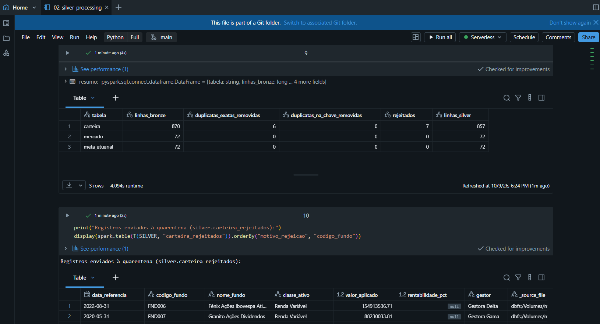

*Camada Gold – verificações de integridade do modelo (todas com 0 violações):*

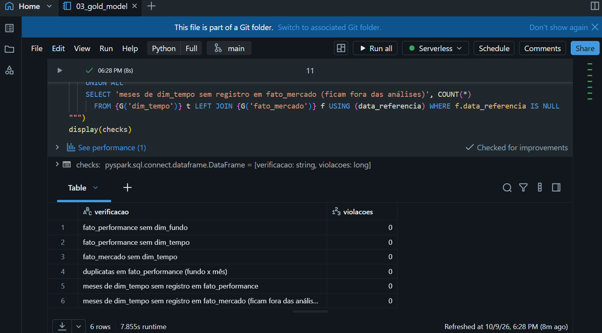

*Camada Gold – tabelas persistidas, com contagem de linhas e amostra (dim_tempo, dim_fundo, fato_performance, fato_mercado, analitico_classe_mensal e analitico_carteira_mensal):*

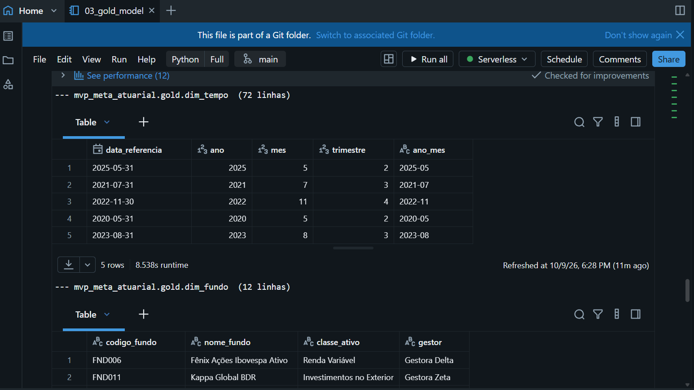
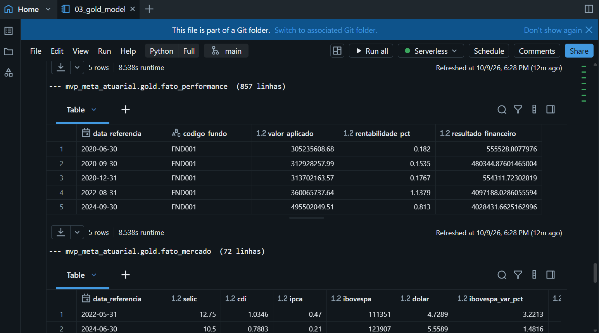
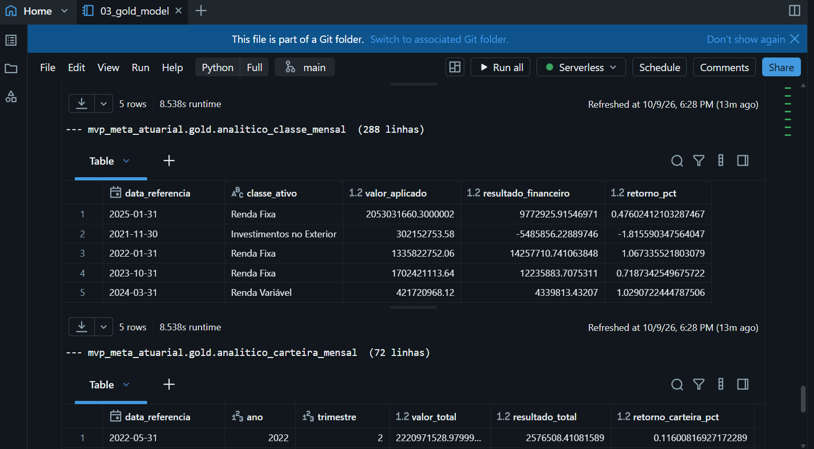

---

## 5. Qualidade de Dados (Etapa 4.5)

### 5.1 Metodologia
O notebook [`04_data_quality.py`](notebooks/04_data_quality.py) verifica, **para cada atributo** e já na captura inicial
(Bronze), as cinco dimensões: **completude**, **consistência**, **unicidade**, **acurácia** e **outliers** (critério IQR,
por classe de ativo ou por fundo). Os resultados são gravados em `silver.dq_checks` e o notebook mostra o comparativo
**Bronze × Silver**, ou seja, o efeito do tratamento.

### 5.2 Problemas injetados deliberadamente e tratamento
Como a carteira é sintética, o gerador injeta (com semente fixa) problemas de qualidade conhecidos para que a etapa tenha o
que detectar. **Isso é declarado aqui por transparência.** Os dados de mercado vêm de fontes reais (Banco Central e Yahoo Finance) e não recebem nenhuma injeção.

| Problema | Qtd. injetada | Dimensão | Tratamento na Silver | Impacto |
|---|---|---|---|---|
| `data_referencia` em `DD/MM/AAAA` | 3 | Consistência | Convertida para data (aceita os dois formatos) | Registros mantidos |
| `rentabilidade_pct` nula | 3 | Completude | Rejeitado → `silver.carteira_rejeitados` | 3 fundo-mês fora da análise |
| `gestor` nulo | 3 | Completude | `Não informado`; a `dim_fundo` usa a gestora informada nos outros meses | Registros mantidos |
| `classe_ativo` com grafia diferente (minúscula, maiúscula, espaços, sem acento) | 4 | Consistência | `trim` + mapeamento canônico | Registros mantidos |
| `rentabilidade_pct` com erro de escala (120% e −85% ao mês) | 2 | Acurácia | Rejeitado (valor absoluto acima de 50% a.m.) | 2 fundo-mês fora da análise |
| `valor_aplicado` negativo | 2 | Acurácia | Rejeitado | 2 fundo-mês fora da análise |
| Linhas duplicadas | 6 | Unicidade | Removidas | Evita dupla contagem |

**Balanço esperado da carteira:** 870 linhas na Bronze − 6 duplicatas − 7 rejeitadas = **857 linhas na Silver**
(7 de 864 fundo-mês ≈ 0,8% fora da análise; efeito desprezível sobre os retornos agregados).

**Achado real na meta atuarial (regra corrigida):** a primeira versão da regra de acurácia exigia `meta_atuarial` entre 0 e 5% a.m.
Na primeira execução, a verificação da Bronze sinalizou 1 mês: julho de 2022, com IPCA de −0,68% e meta atuarial de −0,2754% a.m.
A causa não era erro de dado: em mês de deflação forte do IPCA, a meta `(1+IPCA)×(1+5%)^(1/12)−1` pode ficar negativa. A regra estava
mal calibrada, não o dado; o piso foi ajustado para −2% a.m. (nos notebooks 02 e 04) e a Silver manteve os 72 meses.

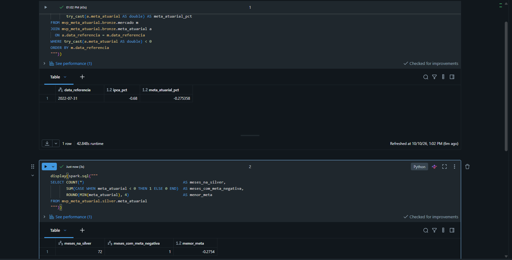

**Outliers:** por classe de ativo, parte dos retornos mensais foge do intervalo do IQR (especialmente renda variável e exterior,
mais voláteis). São variações plausíveis e **foram mantidas** (apenas sinalizadas); só valores impossíveis foram rejeitados. Na carteira, foram sinalizados 51 outliers na Bronze e 46 na Silver (a redução reflete a remoção de duplicatas e de registros inválidos).

**Dados de mercado (reais):** as verificações de completude, consistência, unicidade e acurácia não encontraram problemas nas tabelas
`mercado` e `meta_atuarial` (após o ajuste do piso da meta). Restaram apenas 4 outliers estatísticos em `mercado`, compatíveis com eventos reais
de mercado, como março de 2020 (Ibovespa −29,9% e dólar +15,6%); eles foram mantidos. A evidência está no print 13 (seção 5.3).

### 5.3 Resultados reais da execução

*Problemas detectados na Bronze (notebook 04, executado após o 01):*

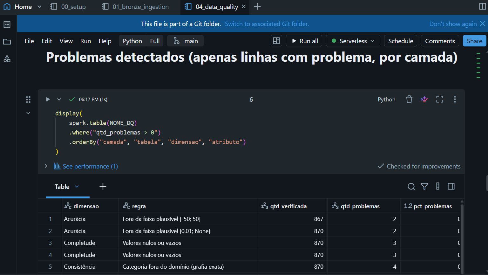

*Comparativo Bronze × Silver (notebook 04, executado após o 03). O `null` na coluna da Silver na regra de data indica que a regra não se aplica: na Silver a coluna já é do tipo DATE.*

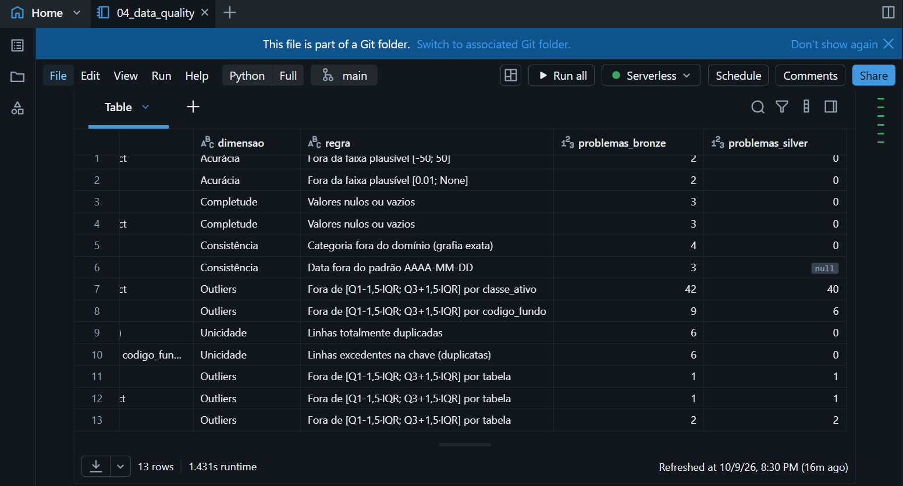

*Evidência de que a verificação foi feita, inclusive nas dimensões sem problemas (por exemplo, as tabelas de mercado):*

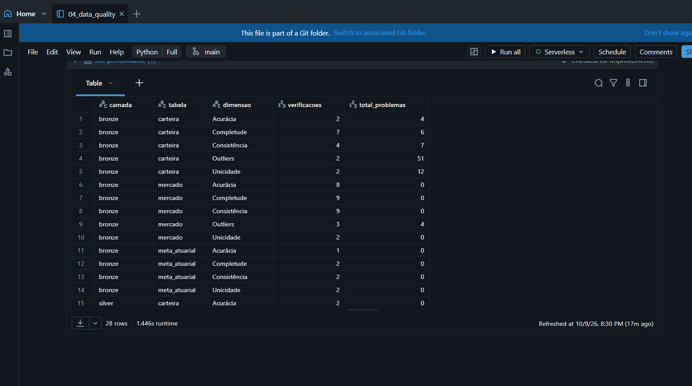

*Registros enviados à quarentena na Silver, com o motivo da rejeição:*

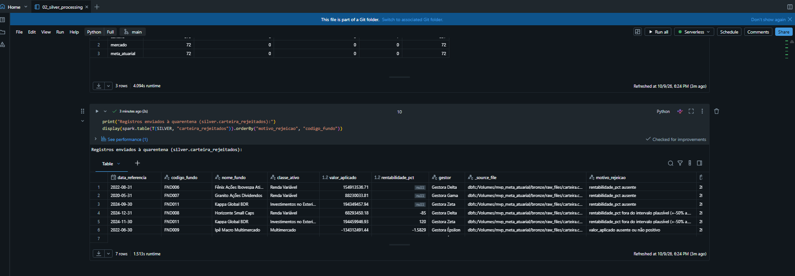

---

## 6. Análise de Dados (Etapa 4.5)

### P1 – A carteira atingiu a meta atuarial?
* **Como:** `analitico_carteira_mensal` compara o retorno mensal ponderado da carteira com a meta; contagem de meses em que
  `atingiu_meta = true`; retorno acumulado composto (`EXP(SUM(LN(1+r)))−1`) versus meta acumulada, no período e por ano.
* **Resultado:**
34 de 72 meses (47,2%). Acumulado: 63,98% contra 86,48% da meta, ou seja, 22,50 p.p. abaixo. Por ano, superou em 2023 (14,14% × 9,85%) e 2025 (13,43% × 9,48%) e ficou abaixo em 2020 (5,94 × 9,74), 2021 (4,54 × 15,56), 2022 (5,42 × 11,07) e 2024 (8,47 × 10,07).
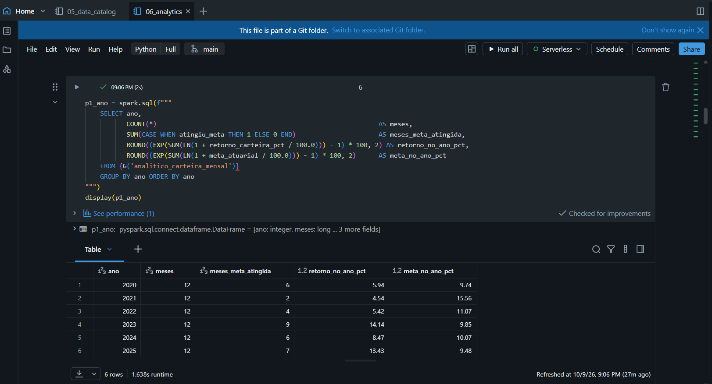
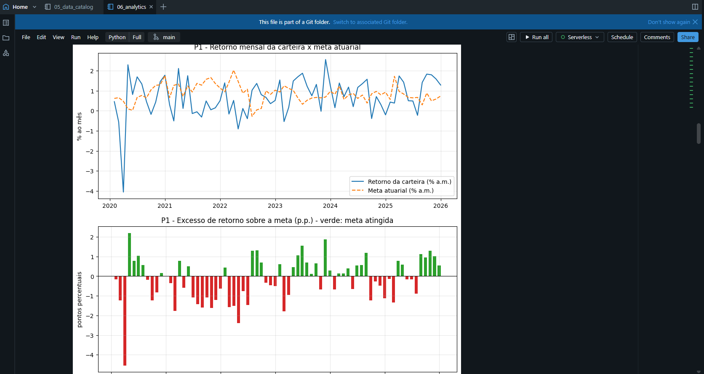
* **Discussão:**
Os resultados indicam que a carteira não atingiu seu principal objetivo de longo prazo, uma vez que superou a meta atuarial em apenas 34 dos 72 meses analisados (47,2%) e acumulou rentabilidade de 63,98%, significativamente inferior aos 86,48% exigidos pela meta. A distância em relação à meta foi maior nos anos de meta elevada, como 2021 (carteira com 4,54% contra meta de 15,56%) e 2022 (5,42% contra 11,07%). Esse resultado sugere que, embora a carteira tenha apresentado ganhos nominais ao longo do período, eles foram insuficientes para acompanhar as exigências atuariais em um horizonte mais amplo.

**Ressalva: carteira sintética; o spread de 5% da meta é premissa do trabalho.**

### P2 – Qual classe mais contribuiu para o resultado financeiro?
* **Como:** `analitico_classe_mensal`: soma do resultado financeiro por classe, % do resultado total, posição média e
  retorno acumulado composto.
* **Resultado:** 
Renda Fixa gerou 64,93% do resultado (R$ 877,4 milhões). Em retorno acumulado, a ordem é Exterior (102,08%), Renda Fixa (68,49%), Multimercado (53,42%) e Renda Variável (42,78%).
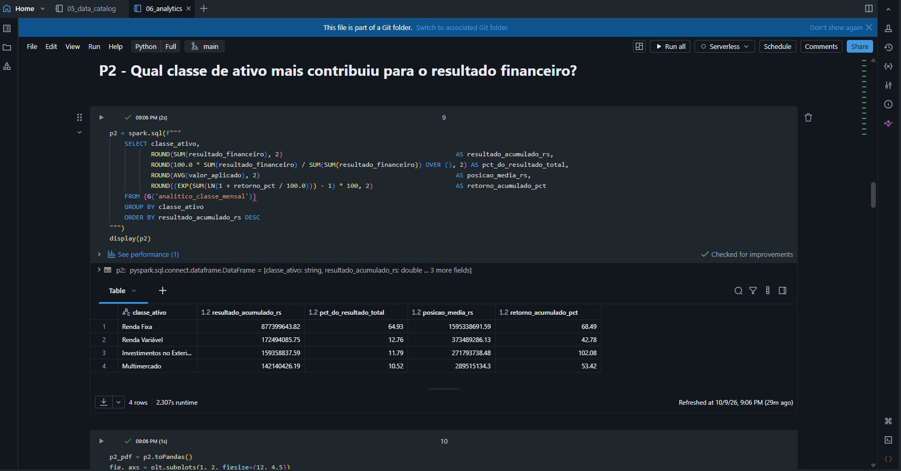
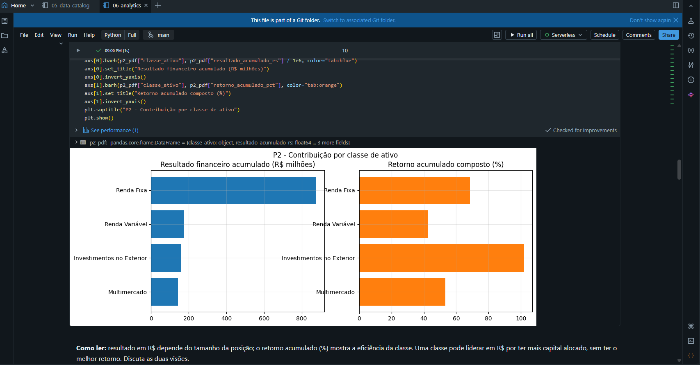
* **Discussão:**
A análise evidencia a importância de diferenciar contribuição para o resultado financeiro e eficiência dos investimentos. A Renda Fixa foi responsável por 64,93% do resultado total da carteira, gerando aproximadamente R$ 877,4 milhões, o que a torna a principal fonte de retorno em termos absolutos. Entretanto, esse resultado deve ser interpretado à luz do volume de recursos alocados, já que a posição média da classe (cerca de R$ 1,6 bilhão) foi significativamente superior às demais.

### P3 – Selic × retorno da renda fixa
* **Como:** correlação de Pearson (`CORR`) entre o retorno mensal da classe Renda Fixa e (a) o nível da Selic,
  (b) o CDI do mês e (c) a variação da Selic; gráficos de dispersão.
* **Resultado:**
72 meses; correlação de 0,56 com o nível da Selic, 0,57 com o CDI e −0,24 com a variação da Selic.
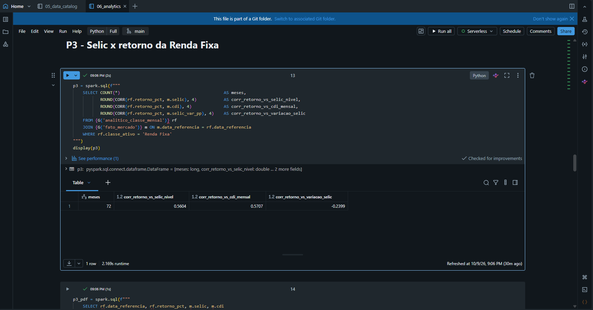
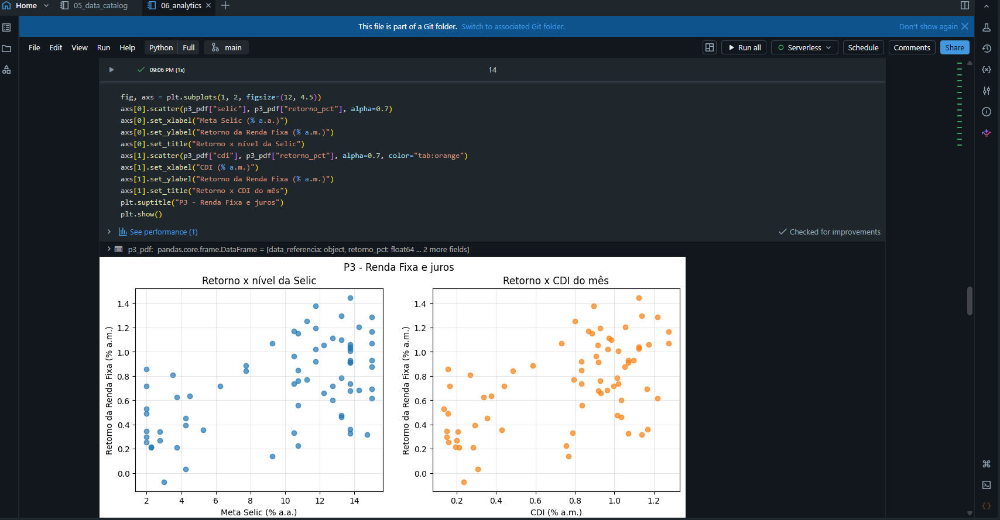
* **Discussão:**
Os resultados indicam que o retorno da renda fixa apresentou correlação positiva moderada tanto com a Selic (0,56) quanto com o CDI (0,57). Isso significa que, em geral, períodos com juros mais elevados estiveram associados a melhores retornos da classe. Entretanto, como os coeficientes estão distantes de 1,0, a relação não é forte nem perfeita, sugerindo que outros fatores além do nível das taxas de juros também influenciam significativamente a rentabilidade dos fundos.

**Ressalva: carteira sintética e o gerador  atrela os fundos CDI ao CDI e os fundos indexados à inflação à variação da Selic; portanto a correlação valida a  coerência do pipeline, não é evidência sobre fundos reais. Correlação não implica causalidade.**

### P4 – Ibovespa × retorno da renda variável
* **Como:** correlação, R² e *beta* (`COVAR_SAMP / VAR_SAMP`) entre o retorno da classe Renda Variável e a variação mensal do
  Ibovespa; dispersão com reta de regressão.
* **Resultado:**
Correlação 0,9883, R² 0,9768, beta 0,9392.
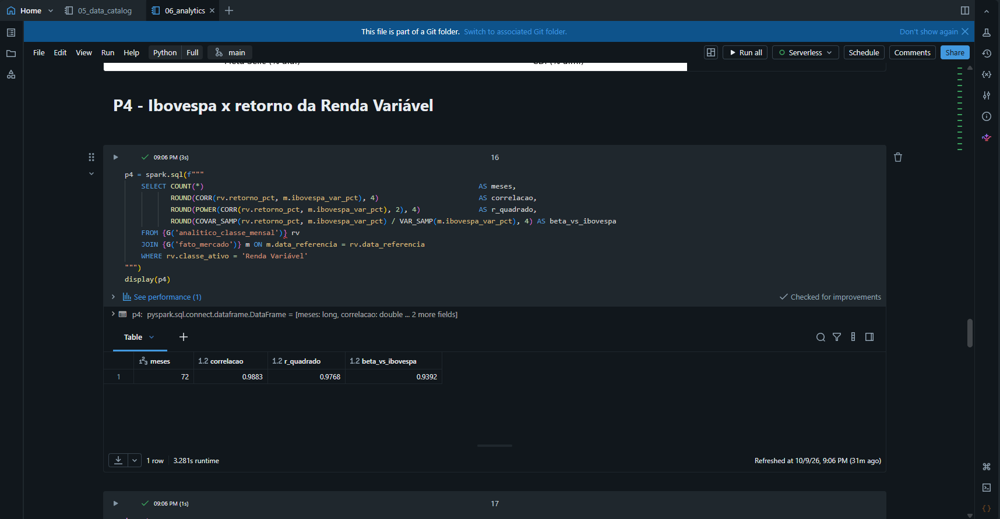
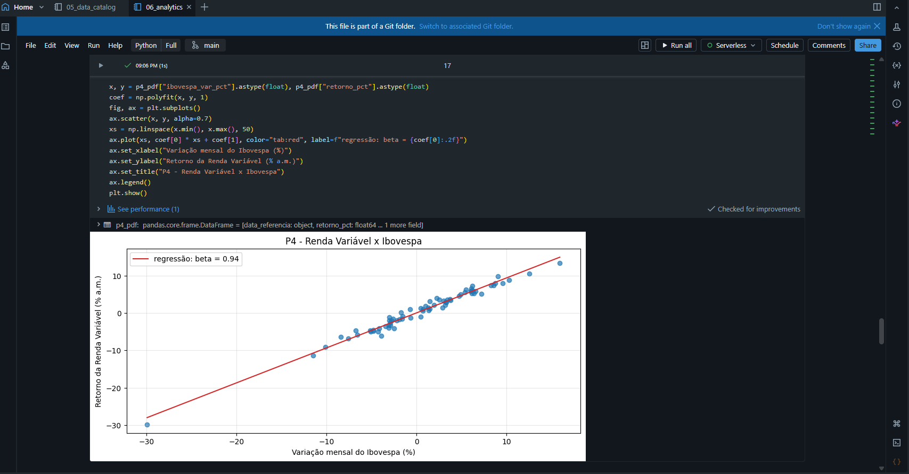
* **Discussão:** 
Os resultados indicam uma relação extremamente forte entre o desempenho da renda variável e o comportamento do Ibovespa. A correlação de 0,9883 está muito próxima de 1, indicando que as duas variáveis se movimentaram praticamente na mesma direção ao longo de todo o período analisado. Da mesma forma, o R² de 0,9768 sugere que aproximadamente 97,7% da variação observada nos retornos da renda variável pode ser explicada pelas oscilações do índice de mercado utilizado como referência.

O beta de 0,9392 fornece uma interpretação ainda mais relevante para a gestão de investimentos. Esse coeficiente indica que, para cada variação de 1% no Ibovespa, a renda variável da carteira tende a variar cerca de 0,94% na mesma direção. Em termos práticos, a classe apresenta uma sensibilidade muito próxima à do mercado acionário brasileiro, porém ligeiramente inferior. Assim, quando o Ibovespa sobe 10%, a expectativa é que a carteira de renda variável apresente ganho próximo de 9,4%; da mesma forma, quedas do mercado tendem a gerar perdas proporcionalmente semelhantes.

**Ressalva: o ajuste é quase perfeito porque os fundos sintéticos foram construídos com betas de 0,75 a 1,15 sobre o Ibovespa. O que ele valida é a engenharia, não o mercado.**

### P5 – Cenários em que a meta é superada
* **Como:** agrupamento de `analitico_carteira_mensal` por `cenario_economico` (juros × bolsa): nº de meses, retorno médio,
  excesso médio sobre a meta e % de meses com meta atingida; também por regime de juros e de bolsa isoladamente.
* **Resultado:**
Meta atingida em 75,6% dos meses de bolsa em alta (n=41) contra 9,7% nos de bolsa em queda (n=31). Por juros: 66,7% com Selic em queda (n=12), 53,7% estável (n=41), 21,1% em alta (n=19). O cenário Selic em queda/bolsa em alta tem 100% mas só n=6.
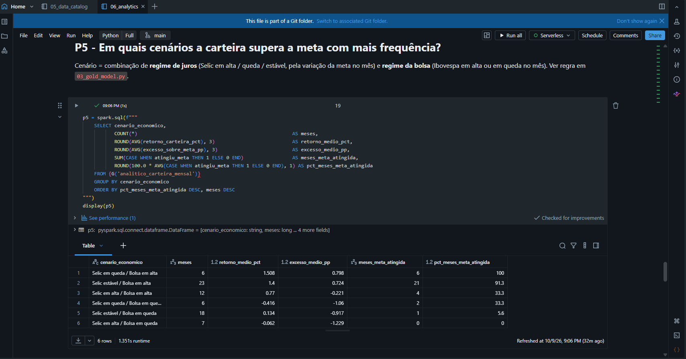
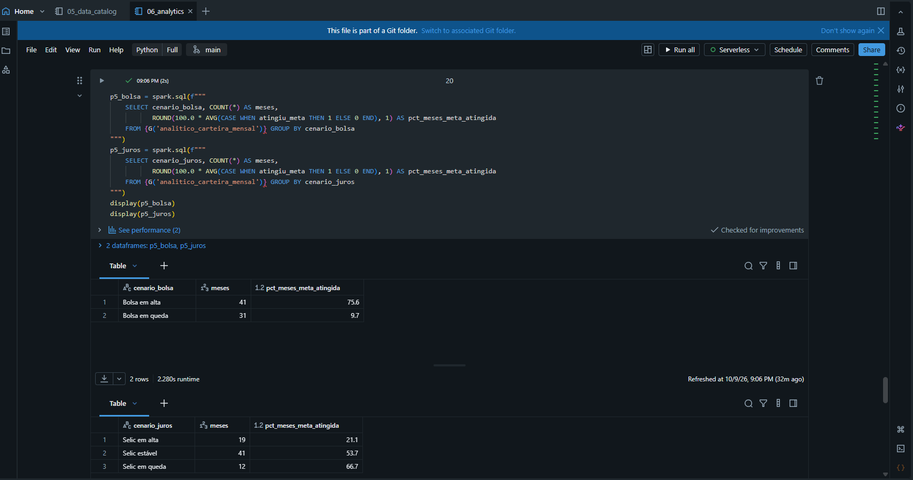
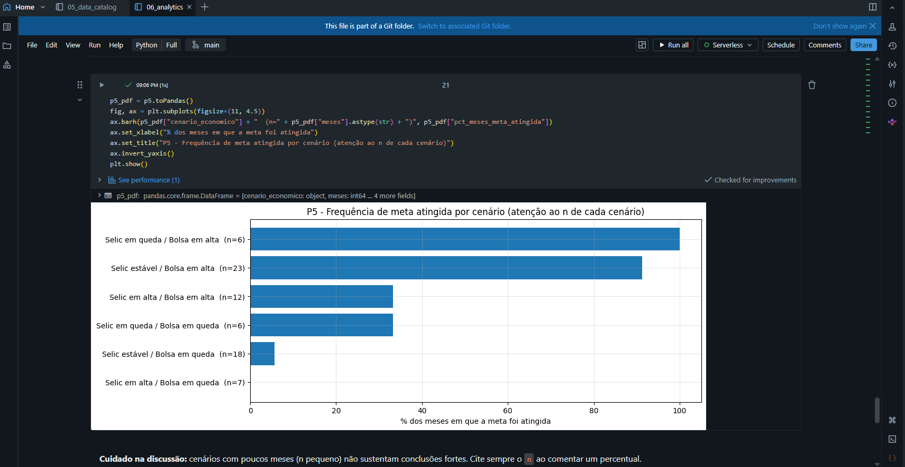
* **Discussão:** 
A análise dos cenários demonstra que o comportamento do mercado acionário foi o fator mais relevante para o atingimento da meta atuarial. Nos meses em que a bolsa esteve em alta (n = 41), a carteira superou a meta em 75,6% das observações, enquanto nos períodos de bolsa em queda (n = 31) esse percentual caiu para apenas 9,7%. Essa diferença expressiva sugere que os ativos de risco tiveram papel importante na geração de retorno suficiente para compensar as exigências atuariais.

Ao analisar isoladamente o comportamento dos juros, observa-se que a carteira apresentou melhor desempenho em ambientes de queda da Selic, nos quais a meta foi atingida em 66,7% dos meses (n = 12). Em cenários de juros estáveis (n = 41), a taxa de sucesso foi de 53,7%, enquanto em períodos de elevação da Selic (n = 19) caiu para 21,1%. Esse resultado é consistente com a interpretação apresentada na análise da renda fixa: embora juros elevados possam beneficiar parte dos investimentos, ciclos de alta costumam gerar ajustes de mercado e elevar a dificuldade de superação da meta atuarial.

Quando os fatores são analisados conjuntamente, observa-se que o cenário de Selic em queda e bolsa em alta apresentou a maior taxa de sucesso, com atingimento da meta em 100% dos meses observados. Entretanto, esse resultado deve ser interpretado com cautela, pois a amostra é reduzida (n = 6). Com um número tão pequeno de observações, não é possível afirmar que esse comportamento se repetiria de forma consistente em períodos mais longos.

Outro resultado interessante é o cenário de Selic em alta e bolsa em alta, no qual a meta foi atingida em apenas 33,3% dos meses (n = 12). Isso sugere que a valorização da bolsa, embora importante, não foi suficiente para garantir o atingimento da meta quando acompanhada por um ambiente de aperto monetário. Em outras palavras, uma bolsa favorável aumenta significativamente as chances de sucesso, mas não elimina os impactos negativos decorrentes da elevação dos juros e do aumento da exigência atuarial.

De forma geral, os resultados indicam que a direção do mercado acionário parece exercer maior influência sobre o atingimento da meta do que o comportamento isolado da Selic. Contudo, a análise mostra também que o melhor desempenho ocorre quando ambos os fatores atuam de forma favorável, ou seja, em ambientes de valorização da bolsa e redução dos juros. Como alguns cenários possuem quantidade limitada de observações, as conclusões devem ser interpretadas como indicativas e não definitivas, reforçando a importância de considerar o tamanho da amostra (n) antes de extrapolar resultados para decisões de investimento.

**Ressalva: juros altos e inflação alta coincidem no tempo, então os efeitos se misturam; cenários com n=6 ou 7 não sustentam conclusões.**

### Discussão geral
O pipeline desenvolvido demonstrou ser capaz de consolidar, tratar e disponibilizar informações de investimentos e mercado em uma estrutura organizada, baseada na arquitetura Medalhão (Bronze, Silver e Gold). A utilização de camadas de tratamento, validações de qualidade e modelagem dimensional permitiu a construção de uma base consistente para análise, garantindo rastreabilidade dos dados e fornecendo informações capazes de responder às cinco perguntas de negócio definidas no início do projeto. Dos 870 registros brutos da carteira, 857 foram aproveitados após a remoção de 6 duplicatas e a quarentena de 7 registros inválidos, todos rastreáveis em silver.carteira_rejeitados. Dessa forma, a área de investimentos passa a dispor de um processo estruturado para acompanhar o atingimento da meta atuarial, identificar os principais responsáveis pelo desempenho da carteira e avaliar a influência das condições de mercado sobre os resultados obtidos.

As análises indicaram que a carteira não atingiu seu objetivo principal no período avaliado, acumulando retorno de 63,98% frente a uma meta atuarial acumulada de 86,48%, além de superar a meta em apenas 34 dos 72 meses analisados (47,2%). Observou-se também que a Renda Fixa foi a principal responsável pelo resultado financeiro em termos absolutos, respondendo por 64,93% dos ganhos acumulados, reflexo da elevada parcela do patrimônio investida nessa classe. Em contrapartida, os investimentos no Exterior apresentaram a maior eficiência em termos de retorno acumulado percentual. A maior eficiência do Exterior decorre da premissa do gerador (dólar mais retorno externo aleatório). A análise dos fatores de mercado mostrou ainda que a renda fixa possui relação positiva moderada com os níveis de Selic e CDI, enquanto a renda variável apresentou forte aderência ao comportamento do Ibovespa. Por fim, os cenários de bolsa em alta mostraram-se mais favoráveis ao atingimento da meta atuarial, sugerindo que o comportamento do mercado acionário teve papel relevante para o desempenho consolidado da carteira (relações construídas pelo gerador de dados sintéticos; ver ressalvas em P3 e P4).

A partir desses resultados, algumas investigações adicionais poderiam ser conduzidas em etapas futuras. Uma primeira linha de aprofundamento seria avaliar se a alocação entre as classes de ativos está adequada ao objetivo de superar a meta atuarial de longo prazo, especialmente considerando a diferença observada entre contribuição financeira e eficiência dos investimentos. Também seria interessante analisar métricas de risco, como volatilidade, drawdown e retorno ajustado ao risco, para verificar se as classes mais rentáveis mantiveram desempenho consistente ao longo do tempo. Além disso, poderiam ser incorporados modelos de atribuição de performance, análise por gestor e simulações de rebalanceamento da carteira. Essas avaliações complementares permitiriam compreender não apenas se a meta foi atingida, mas principalmente quais decisões de alocação têm maior potencial para aumentar a probabilidade de atingimento das metas previdenciárias futuras.

### Limitações
Os resultados devem ser interpretados considerando que a carteira analisada foi construída com dados sintéticos gerados para fins acadêmicos. As premissas utilizadas incluem um spread atuarial fixo de 5%, um horizonte de 72 meses e uma carteira composta por 12 fundos simulados. Além disso, não foram considerados custos operacionais, taxas de administração, tributação ou restrições regulatórias específicas que normalmente afetam o desempenho de carteiras reais. Portanto, os resultados permitem validar a arquitetura e o processo analítico propostos, mas não devem ser interpretados como representação do desempenho efetivo de uma carteira real de investimentos.

---

## 7. Autoavaliação

### 7.1 Objetivos atingidos
| Pergunta | Respondida? | Comentário |
|---|---|---|
| P1 – Meta atuarial | Sim | A carteira não atingiu a meta: 34 de 72 meses (47,2%) e 63,98% acumulado contra 86,48%. |
| P2 – Contribuição por classe | Sim | Renda Fixa lidera em R$ (64,93%); o Exterior lidera em retorno acumulado (102,08%). |
| P3 – Selic × renda fixa | Sim, com ressalva | Correlação moderada (0,56 com a Selic; 0,57 com o CDI); relação construída pelo gerador, não evidência sobre fundos reais. |
| P4 – Ibovespa × renda variável | Sim, com ressalva | Correlação de 0,99 e beta de 0,94, também decorrentes do gerador. |
| P5 – Cenários | Sim, com cautela | Bolsa em alta: meta atingida em 75,6% dos meses (n=41), contra 9,7% na bolsa em queda (n=31); cenários combinados têm poucos meses (n de 6 a 23). |

Considero que o objetivo principal do MVP foi atingido: construir um pipeline completo, documentado e reproduzível
(coleta, Bronze, Silver, Gold, qualidade, catálogo e análise) capaz de responder todas as perguntas definidas.
O que não foi possível é tirar conclusões sobre fundos reais, porque a carteira é sintética.

### 7.2 Dificuldades encontradas
* **Fonte do Ibovespa.** A série 7 do SGS (Banco Central) retornou dados só até 2019 e o script falhou para 2020.
  Troquei a fonte pelo Yahoo Finance (biblioteca `yfinance`) e tive de revisar a seção de licenças e termos de uso.
* **Regra de qualidade mal calibrada.** A primeira regra de acurácia exigia meta atuarial entre 0 e 5% a.m. A verificação
  sinalizou julho de 2022 (IPCA de −0,68% e meta de −0,2754%). O problema estava na minha regra, não no dado: a meta pode
  ser negativa em mês de deflação. Ajustei o piso para −2% e mantive os 72 meses.
* **Ambiente.** O instalador novo do Python exibiu mensagens que pareciam erros, mas eram configurações opcionais, e a
  interface do Databricks era diferente do tutorial (o seletor *Serverless* no lugar do botão *Connect*).
  Também demorei a entender que as imagens e o README ficam no GitHub, enquanto o Databricks só executa os notebooks.
* **Leitura dos resultados.** Precisei distinguir erro de dado de outlier legítimo (os 46 outliers da Silver foram
  mantidos e sinalizados), contribuição em R$ de eficiência (retorno %), e conclusão de cenário com n pequeno.

### 7.3 Aprendizados e limitações
O principal aprendizado foi o raciocínio de ponta a ponta: cada etapa depende das decisões da anterior, e as verificações
de qualidade detectam problemas que a análise final esconderia. As limitações são as descritas na seção 6 (carteira
sintética, spread de 5% como premissa, 72 meses e 12 fundos, sem custos ou tributação).

### 7.4 Trabalhos futuros
* Substituir a carteira sintética por dados reais públicos de fundos (informes diários da CVM).
* Orquestrar o pipeline com Databricks Workflows e carga incremental mensal.
* Transformar as verificações de qualidade em testes automáticos que interrompam o pipeline em caso de violação.
* Criar um painel sobre as tabelas Gold e métricas de risco (volatilidade, drawdown, retorno ajustado ao risco).
* Analisar a sensibilidade da meta atuarial a diferentes valores de spread.

### 7.5 Uso de ferramentas de IA
Utilizei IA como apoio para estruturar o pipeline e tirar dúvidas; executei e validei o código no Databricks, e redigi as análises e discussões também com o apoio de IA, para dar mais corpo ao trabalho.

---

## 8. Como reproduzir
1. Clonar o repositório e instalar dependências locais: `pip install -r requirements.txt`.
2. `python scripts/01_baixar_dados_bcb.py` e `python scripts/02_gerar_carteira_sintetica.py` (geram `dados/*.csv`).
3. No Databricks Free Edition: **Workspace → Create → Git folder**, apontando para este repositório.
4. Executar na ordem: `00_setup` → upload dos CSVs no Volume → `01_bronze_ingestion` → `04_data_quality` (Bronze) →
   `02_silver_processing` → `03_gold_model` → `04_data_quality` (Bronze × Silver) → `05_data_catalog` → `06_analytics`.
5. Se `CREATE CATALOG` não for permitido, ajustar `CATALOG` em `notebooks/config.py` para o catálogo padrão do workspace.

## 9. Estrutura do repositório
```
mvp_meta_atuarial/
├── README.md                      <- este documento (relatório do MVP)
├── requirements.txt
├── scripts/
│   ├── 01_baixar_dados_bcb.py     <- coleta dos indicadores reais (API SGS/BCB e Yahoo Finance)
│   └── 02_gerar_carteira_sintetica.py
├── notebooks/                     <- notebooks Databricks (formato-fonte .py)
│   ├── config.py   catalogo.py
│   ├── 00_setup.py   01_bronze_ingestion.py   02_silver_processing.py   03_gold_model.py
│   └── 04_data_quality.py   05_data_catalog.py   06_analytics.py
├── docs/
│   ├── catalogo_dados.md
│   └── img/                       <- screenshots (evidências)
└── dados/                         <- CSVs gerados localmente (não versionados)
```
