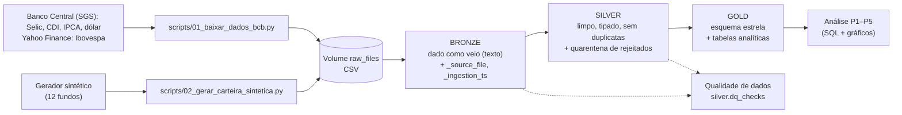
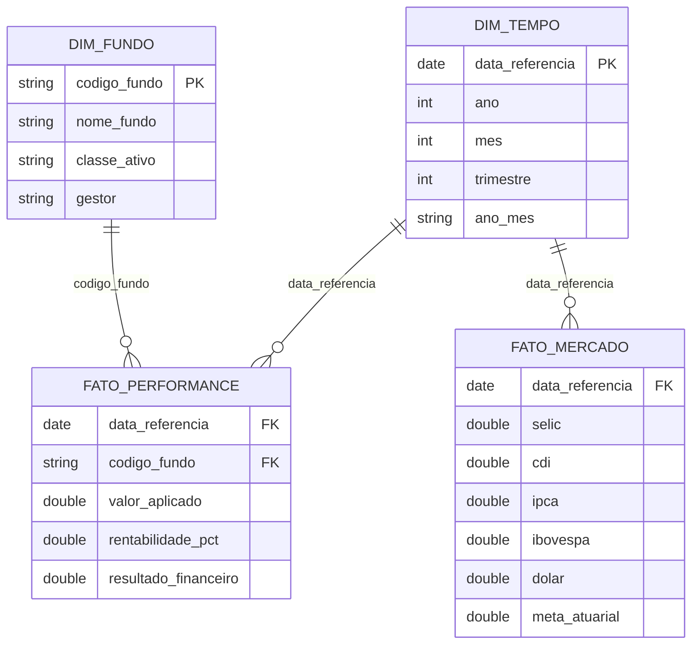

# MVP – Pipeline de Dados na Nuvem para Monitoramento da Meta Atuarial de um RPPS

**Disciplina:** Engenharia de Dados – MVP (PUC-Rio)
**Aluno(a):** ⚠️ PREENCHER (nome completo)
**Plataforma:** Databricks Free Edition (Unity Catalog, Volumes, Delta Lake, Spark SQL/PySpark)
**Repositório:** ⚠️ PREENCHER (link público do GitHub)

> **Legenda:** trechos marcados com ⚠️ **PREENCHER** dependem da execução no *seu* Databricks (screenshots e números) e
> não podem ser escritos antes. Apague esta legenda e todos os avisos antes de entregar.

## Sumário
1. [Contexto de Negócio e Perguntas (Etapa 2 e 4.1)](#1-contexto-de-negócio-e-perguntas-etapa-2-e-41)
2. [Carga dos Dados (Etapa 4.2)](#2-carga-dos-dados-etapa-42)
3. [Modelagem e Catálogo de Dados (Etapa 4.3)](#3-modelagem-e-catálogo-de-dados-etapa-43)
4. [Pipeline de Dados (Etapa 4.4)](#4-pipeline-de-dados-etapa-44)
5. [Qualidade de Dados (Etapa 4.5)](#5-qualidade-de-dados-etapa-45)
6. [Análise de Dados (Etapa 4.5)](#6-análise-de-dados-etapa-45)
7. [Autoavaliação](#7-autoavaliação)
8. [Como reproduzir](#8-como-reproduzir)
9. [Estrutura do repositório](#9-estrutura-do-repositório)

---

## 1. Contexto de Negócio e Perguntas (Etapa 2 e 4.1)

### 1.1 Problema
Um regime próprio de previdência social (RPPS) precisa que sua carteira de investimentos renda, ao longo do tempo, pelo menos
a **meta atuarial** – o retorno mínimo necessário para honrar os compromissos com os beneficiários. A área de investimentos
acompanha isso manualmente, em planilhas, mês a mês, o que dificulta responder rapidamente: *a carteira está batendo a meta?
Quais classes de ativos sustentam o resultado? O que acontece com a carteira quando os juros ou a bolsa mudam?*

**Objetivo do MVP:** construir, de ponta a ponta e na nuvem, um pipeline de dados (coleta → Bronze → Silver → Gold → análise)
que entregue dados confiáveis e documentados para responder essas perguntas.

### 1.2 Perguntas de negócio
| # | Pergunta | Tabela Gold que responde |
|---|---|---|
| **P1** | A carteira atingiu a meta atuarial? Em quantos meses e no acumulado do período? | `analitico_carteira_mensal` |
| **P2** | Qual classe de ativo mais contribuiu para o resultado financeiro? | `analitico_classe_mensal` |
| **P3** | Existe relação entre a Selic e o retorno dos fundos de renda fixa? | `analitico_classe_mensal` + `fato_mercado` |
| **P4** | Existe relação entre o Ibovespa e o retorno dos fundos de renda variável? | `analitico_classe_mensal` + `fato_mercado` |
| **P5** | Em quais cenários econômicos (juros e bolsa) a carteira supera a meta com mais frequência? | `analitico_carteira_mensal` |

### 1.3 Escopo e premissas
* **Período:** janeiro/2020 a dezembro/2025 (72 meses). **Granularidade:** mensal. **Atualização:** carga em lote (*batch*) mensal.
* **Carteira fictícia:** 12 fundos em 4 classes (Renda Fixa, Renda Variável, Multimercado, Investimentos no Exterior), com
  gestoras e valores inventados. Posições reais de um RPPS são dados sensíveis e não devem ser enviados a ambiente externo
  (orientação do MVP, item 4.2).
* **Mercado real:** Selic, CDI, IPCA e dólar vêm de dados abertos do Banco Central (SGS); o Ibovespa vem do fechamento diário do índice (^BVSP) no Yahoo Finance, coletado pela biblioteca `yfinance`.
* **Meta atuarial (premissa do trabalho):** `IPCA + 5,0% a.a.`, convertida para mensal:
  `meta_mensal = (1 + IPCA_mensal) × (1 + 5%)^(1/12) − 1`. O spread de 5,0% é uma **premissa didática** (parâmetro
  `--spread-aa` do script de coleta); a meta de um RPPS real é definida na sua política de investimentos.
* **Retorno agregado** (carteira ou classe) = `Σ resultado financeiro / Σ posição` (média ponderada pela posição).
* **Cenário econômico:** *juros* = Selic em alta / queda / estável (variação da meta Selic no mês); *bolsa* = Ibovespa em alta
  (variação ≥ 0) ou em queda (< 0).

### 1.4 Dados brutos: origem e estrutura
| Arquivo | Origem | Linhas | Colunas brutas |
|---|---|---|---|
| `mercado.csv` | API SGS do Banco Central (séries 432 Selic meta, 12 CDI diário, 433 IPCA, 1 dólar venda) e Yahoo Finance (Ibovespa, ^BVSP), agregados por mês pelo script `01_baixar_dados_bcb.py` | 72 | `data_referencia, selic, cdi, ipca, ibovespa, dolar, ibovespa_var_pct, dolar_var_pct, selic_var_pp` |
| `meta_atuarial.csv` | Calculada pelo mesmo script a partir do IPCA real (IPCA + 5,0% a.a.) | 72 | `data_referencia, meta_atuarial` |
| `carteira.csv` | **Sintética**, gerada por `02_gerar_carteira_sintetica.py` (semente 42) a partir do mercado real | 870* | `data_referencia, codigo_fundo, nome_fundo, classe_ativo, valor_aplicado, rentabilidade_pct, gestor` |

\* 12 fundos × 72 meses = 864 + 6 linhas duplicadas injetadas de propósito (ver seção 5).

A descrição campo a campo (tipo, domínio, linhagem) está no catálogo da seção 3.

### 1.5 Licença e uso dos dados
* **Dados do Banco Central (SGS):** dados abertos do BCB. O portal de dados abertos do Banco Central indica a licença
  *Open Data Commons Open Database License (ODbL) v1.0*. ⚠️ **PREENCHER/CONFERIR:** abra a página de dados abertos de uma das
  séries, confirme a licença e cole aqui o link. O IPCA é produzido pelo IBGE e o Ibovespa é um índice da B3; ambos são
  usados aqui apenas para fins acadêmicos.
* **Ibovespa (Yahoo Finance):** os fechamentos foram obtidos pela biblioteca de código aberto `yfinance`, para uso pessoal e acadêmico.
  ⚠️ **PREENCHER/CONFERIR:** leia os termos de uso do Yahoo Finance e cite o link aqui, registrando que o uso é exclusivamente acadêmico
  e que o Ibovespa é propriedade da B3 (a B3 também publica a série histórica oficial em sua página de estatísticas históricas do índice).
* **Carteira de fundos:** dados fictícios gerados pelo autor; não há restrição de licença. Não representam nenhum RPPS real.

### 1.6 Premissa metodológica importante
Como a rentabilidade dos fundos sintéticos é construída como função do mercado real mais ruído aleatório
(`02_gerar_carteira_sintetica.py`), **as relações encontradas em P3 e P4 refletem as premissas do gerador**. O MVP demonstra
a *metodologia* e a *engenharia* do pipeline, não descobertas sobre fundos reais. Isso é discutido na seção 6 e na autoavaliação.

---

## 2. Carga dos Dados (Etapa 4.2)

**Estratégia:** *caso simples* das orientações – gerar os arquivos CSV e fazer upload para um **Volume** do Unity Catalog
(`/Volumes/mvp_meta_atuarial/bronze/raw_files`), de onde o notebook de ingestão os lê.

1. No computador local, rodar os scripts (o acesso à API do BCB exige internet):
   * `python scripts/01_baixar_dados_bcb.py` → gera `dados/mercado.csv` e `dados/meta_atuarial.csv`
   * `python scripts/02_gerar_carteira_sintetica.py` → gera `dados/carteira.csv`
2. No Databricks, executar `notebooks/00_setup.py` (cria catálogo, schemas e o Volume `raw_files`).
3. Em **Catalog → mvp_meta_atuarial → bronze → raw_files → Upload to this volume**, enviar os 3 CSVs.
4. Executar `notebooks/01_bronze_ingestion.py`.

**Scripts de coleta no GitHub:** [`scripts/01_baixar_dados_bcb.py`](scripts/01_baixar_dados_bcb.py) e
[`scripts/02_gerar_carteira_sintetica.py`](scripts/02_gerar_carteira_sintetica.py).
O script 01 valida os valores baixados (faixas plausíveis por indicador) antes de gravar os CSVs. A série 7 do SGS (Ibovespa) foi testada e
descartada porque só traz dados até 2019; por isso o índice vem do Yahoo Finance (registre isso na autoavaliação, como dificuldade real).

**Evidências (screenshots):**
> ⚠️ **PREENCHER** com imagens em `docs/img/`:
> 1. Saída do script `01_baixar_dados_bcb.py` no terminal (período e primeiras/últimas linhas);
> 2. Volume `raw_files` com os 3 arquivos enviados;
> 3. Saída do notebook `01_bronze_ingestion` (contagem de linhas por tabela).

---

## 3. Modelagem e Catálogo de Dados (Etapa 4.3)

### 3.1 Arquitetura Medalhão


### 3.2 Modelo dimensional (Gold) – Esquema Estrela

* **Granularidade:** `fato_performance` = fundo × mês; `fato_mercado` = mês.
* **Por que estrela e não *flat*?** As perguntas cruzam o desempenho dos fundos (por classe, por mês) com o mercado (por mês).
  Fatos separados com dimensões compartilhadas evitam repetir o mercado em cada linha de fundo e deixam as consultas simples.
* **Tabelas analíticas** (`analitico_carteira_mensal`, `analitico_classe_mensal`) pré-agregam o que as perguntas P1–P5 consomem.

### 3.3 Catálogo de Dados
O catálogo abaixo descreve **todas as tabelas e colunas** (descrição, tipo, domínio de valores e linhagem). Ele é gerado a partir
de [`notebooks/catalogo.py`](notebooks/catalogo.py) – a mesma fonte usada pelo notebook `05_data_catalog.py` para gravar os
`COMMENT` no **Unity Catalog** – e também está em [`docs/catalogo_dados.md`](docs/catalogo_dados.md).

> ⚠️ **PREENCHER** – screenshots do sistema de catálogo (Unity Catalog), em `docs/img/`:
> 1. Catalog Explorer mostrando as tabelas dos 3 schemas;
> 2. Aba *Overview* de uma tabela Gold com descrição e comentários das colunas;
> 3. Aba *Lineage* de `gold.analitico_carteira_mensal` (grafo de linhagem);
> 4. Resultado da consulta em `information_schema.columns` (última célula do notebook `05`).

### Camada Bronze (dado bruto)

<details><summary>Expandir catálogo desta camada</summary>

#### `bronze.carteira`

**Descrição:** Posição mensal (sintética) dos 12 fundos da carteira do RPPS, exatamente como recebida do CSV (tudo texto) + metadados de ingestão.

**Linhagem da tabela:** carteira.csv (gerado por scripts/02_gerar_carteira_sintetica.py)

| Campo | Descrição | Tipo | Domínio de valores | Linhagem |
|---|---|---|---|---|
| `data_referencia` | [Bruto, texto] Data de referência da observação (último dia do mês) | STRING | Último dia de cada mês entre 2020-01-31 e 2025-12-31 (72 meses) | Arquivo de origem: carteira.csv (gerado por scripts/02_gerar_carteira_sintetica.py), coluna data_referencia |
| `codigo_fundo` | [Bruto, texto] Código identificador do fundo de investimento (chave natural) | STRING | FND001 a FND012 | Arquivo de origem: carteira.csv (gerado por scripts/02_gerar_carteira_sintetica.py), coluna codigo_fundo |
| `nome_fundo` | [Bruto, texto] Nome (fictício) do fundo de investimento | STRING | 12 nomes distintos, 1 por código | Arquivo de origem: carteira.csv (gerado por scripts/02_gerar_carteira_sintetica.py), coluna nome_fundo |
| `classe_ativo` | [Bruto, texto] Classe de ativo do fundo | STRING | Renda Fixa; Renda Variável; Multimercado; Investimentos no Exterior | Arquivo de origem: carteira.csv (gerado por scripts/02_gerar_carteira_sintetica.py), coluna classe_ativo |
| `valor_aplicado` | [Bruto, texto] Posição do RPPS no fundo no início do mês de referência, em R$ | STRING | Maior que 0 | Arquivo de origem: carteira.csv (gerado por scripts/02_gerar_carteira_sintetica.py), coluna valor_aplicado |
| `rentabilidade_pct` | [Bruto, texto] Rentabilidade do fundo no mês de referência, em % (1,25 = 1,25%) | STRING | Entre -50 e +50 % a.m. (faixa de plausibilidade) | Arquivo de origem: carteira.csv (gerado por scripts/02_gerar_carteira_sintetica.py), coluna rentabilidade_pct |
| `gestor` | [Bruto, texto] Gestora (fictícia) responsável pelo fundo | STRING | Gestora Alfa, Beta, Gama, Delta, Épsilon, Zeta; 'Não informado' quando ausente (Silver) | Arquivo de origem: carteira.csv (gerado por scripts/02_gerar_carteira_sintetica.py), coluna gestor |
| `_source_file` | Caminho do arquivo de origem no Volume (rastreabilidade) | STRING | Caminho em /Volumes/... | Gerado na ingestão (01_bronze_ingestion.py) |
| `_ingestion_ts` | Data/hora da ingestão na camada Bronze | TIMESTAMP | Timestamp UTC da carga | Gerado na ingestão (01_bronze_ingestion.py) |

#### `bronze.mercado`

**Descrição:** Indicadores macroeconômicos mensais reais (Banco Central), como recebidos do CSV (tudo texto) + metadados de ingestão.

**Linhagem da tabela:** mercado.csv (gerado por scripts/01_baixar_dados_bcb.py a partir das séries SGS do Banco Central: 432 Selic meta, 12 CDI, 433 IPCA, 1 dólar; e do fechamento do Ibovespa (^BVSP) obtido do Yahoo Finance)

| Campo | Descrição | Tipo | Domínio de valores | Linhagem |
|---|---|---|---|---|
| `data_referencia` | [Bruto, texto] Data de referência da observação (último dia do mês) | STRING | Último dia de cada mês entre 2020-01-31 e 2025-12-31 (72 meses) | Arquivo de origem: mercado.csv (gerado por scripts/01_baixar_dados_bcb.py a partir das séries SGS do Banco Central: 432 Selic meta, 12 CDI, 433 IPCA, 1 dólar; e do fechamento do Ibovespa (^BVSP) obtido do Yahoo Finance), coluna data_referencia |
| `selic` | [Bruto, texto] Meta Selic vigente no fim do mês, em % ao ano | STRING | Entre 0 e 50 % a.a. | Arquivo de origem: mercado.csv (gerado por scripts/01_baixar_dados_bcb.py a partir das séries SGS do Banco Central: 432 Selic meta, 12 CDI, 433 IPCA, 1 dólar; e do fechamento do Ibovespa (^BVSP) obtido do Yahoo Finance), coluna selic |
| `cdi` | [Bruto, texto] CDI acumulado no mês (taxas diárias compostas), em % ao mês | STRING | Entre 0 e 5 % a.m. | Arquivo de origem: mercado.csv (gerado por scripts/01_baixar_dados_bcb.py a partir das séries SGS do Banco Central: 432 Selic meta, 12 CDI, 433 IPCA, 1 dólar; e do fechamento do Ibovespa (^BVSP) obtido do Yahoo Finance), coluna cdi |
| `ipca` | [Bruto, texto] IPCA - variação mensal, em % ao mês | STRING | Entre -2 e 5 % a.m. | Arquivo de origem: mercado.csv (gerado por scripts/01_baixar_dados_bcb.py a partir das séries SGS do Banco Central: 432 Selic meta, 12 CDI, 433 IPCA, 1 dólar; e do fechamento do Ibovespa (^BVSP) obtido do Yahoo Finance), coluna ipca |
| `ibovespa` | [Bruto, texto] Índice Ibovespa, pontos no último pregão do mês | STRING | Entre 10.000 e 300.000 pontos | Arquivo de origem: mercado.csv (gerado por scripts/01_baixar_dados_bcb.py a partir das séries SGS do Banco Central: 432 Selic meta, 12 CDI, 433 IPCA, 1 dólar; e do fechamento do Ibovespa (^BVSP) obtido do Yahoo Finance), coluna ibovespa |
| `dolar` | [Bruto, texto] Dólar comercial (venda), R$ por US$, no último dia do mês | STRING | Entre 1 e 10 R$/US$ | Arquivo de origem: mercado.csv (gerado por scripts/01_baixar_dados_bcb.py a partir das séries SGS do Banco Central: 432 Selic meta, 12 CDI, 433 IPCA, 1 dólar; e do fechamento do Ibovespa (^BVSP) obtido do Yahoo Finance), coluna dolar |
| `ibovespa_var_pct` | [Bruto, texto] Variação percentual do Ibovespa em relação ao mês anterior | STRING | Entre -50 e +50 % | Arquivo de origem: mercado.csv (gerado por scripts/01_baixar_dados_bcb.py a partir das séries SGS do Banco Central: 432 Selic meta, 12 CDI, 433 IPCA, 1 dólar; e do fechamento do Ibovespa (^BVSP) obtido do Yahoo Finance), coluna ibovespa_var_pct |
| `dolar_var_pct` | [Bruto, texto] Variação percentual do dólar em relação ao mês anterior | STRING | Entre -50 e +50 % | Arquivo de origem: mercado.csv (gerado por scripts/01_baixar_dados_bcb.py a partir das séries SGS do Banco Central: 432 Selic meta, 12 CDI, 433 IPCA, 1 dólar; e do fechamento do Ibovespa (^BVSP) obtido do Yahoo Finance), coluna dolar_var_pct |
| `selic_var_pp` | [Bruto, texto] Variação da Meta Selic em relação ao mês anterior, em pontos percentuais | STRING | Entre -5 e +5 p.p.; 0 = sem mudança | Arquivo de origem: mercado.csv (gerado por scripts/01_baixar_dados_bcb.py a partir das séries SGS do Banco Central: 432 Selic meta, 12 CDI, 433 IPCA, 1 dólar; e do fechamento do Ibovespa (^BVSP) obtido do Yahoo Finance), coluna selic_var_pp |
| `_source_file` | Caminho do arquivo de origem no Volume (rastreabilidade) | STRING | Caminho em /Volumes/... | Gerado na ingestão (01_bronze_ingestion.py) |
| `_ingestion_ts` | Data/hora da ingestão na camada Bronze | TIMESTAMP | Timestamp UTC da carga | Gerado na ingestão (01_bronze_ingestion.py) |

#### `bronze.meta_atuarial`

**Descrição:** Meta atuarial mensal (IPCA + 5,0% a.a.), como recebida do CSV (tudo texto) + metadados de ingestão.

**Linhagem da tabela:** meta_atuarial.csv (gerado por scripts/01_baixar_dados_bcb.py: IPCA real + spread de 5,0% a.a.)

| Campo | Descrição | Tipo | Domínio de valores | Linhagem |
|---|---|---|---|---|
| `data_referencia` | [Bruto, texto] Data de referência da observação (último dia do mês) | STRING | Último dia de cada mês entre 2020-01-31 e 2025-12-31 (72 meses) | Arquivo de origem: meta_atuarial.csv (gerado por scripts/01_baixar_dados_bcb.py: IPCA real + spread de 5,0% a.a.), coluna data_referencia |
| `meta_atuarial` | [Bruto, texto] Meta atuarial mensal = (1+IPCA)*(1+spread)^(1/12)-1, com spread real de 5,0% a.a. (premissa), em % ao mês | STRING | Entre 0 e 5 % a.m. | Arquivo de origem: meta_atuarial.csv (gerado por scripts/01_baixar_dados_bcb.py: IPCA real + spread de 5,0% a.a.), coluna meta_atuarial |
| `_source_file` | Caminho do arquivo de origem no Volume (rastreabilidade) | STRING | Caminho em /Volumes/... | Gerado na ingestão (01_bronze_ingestion.py) |
| `_ingestion_ts` | Data/hora da ingestão na camada Bronze | TIMESTAMP | Timestamp UTC da carga | Gerado na ingestão (01_bronze_ingestion.py) |

</details>

### Camada Silver (dado limpo e padronizado)

<details><summary>Expandir catálogo desta camada</summary>

#### `silver.carteira`

**Descrição:** Posição mensal dos fundos limpa, tipada e padronizada (sem duplicatas; registros inválidos enviados a silver.carteira_rejeitados).

**Linhagem da tabela:** bronze.carteira

| Campo | Descrição | Tipo | Domínio de valores | Linhagem |
|---|---|---|---|---|
| `data_referencia` | Data de referência da observação (último dia do mês) | DATE | Último dia de cada mês entre 2020-01-31 e 2025-12-31 (72 meses) | bronze.carteira.data_referencia (aceita AAAA-MM-DD e DD/MM/AAAA; ajustada ao último dia do mês) |
| `codigo_fundo` | Código identificador do fundo de investimento (chave natural) | STRING | FND001 a FND012 | bronze.carteira.codigo_fundo |
| `nome_fundo` | Nome (fictício) do fundo de investimento | STRING | 12 nomes distintos, 1 por código | bronze.carteira.nome_fundo |
| `classe_ativo` | Classe de ativo do fundo | STRING | Renda Fixa; Renda Variável; Multimercado; Investimentos no Exterior | bronze.carteira.classe_ativo (trim + mapeamento para a grafia canônica) |
| `valor_aplicado` | Posição do RPPS no fundo no início do mês de referência, em R$ | DOUBLE | Maior que 0 | bronze.carteira.valor_aplicado |
| `rentabilidade_pct` | Rentabilidade do fundo no mês de referência, em % (1,25 = 1,25%) | DOUBLE | Entre -50 e +50 % a.m. (faixa de plausibilidade) | bronze.carteira.rentabilidade_pct |
| `gestor` | Gestora (fictícia) responsável pelo fundo | STRING | Gestora Alfa, Beta, Gama, Delta, Épsilon, Zeta; 'Não informado' quando ausente (Silver) | bronze.carteira.gestor (nulo/vazio vira 'Não informado') |
| `_processed_ts` | Data/hora do processamento na camada Silver | TIMESTAMP | Timestamp UTC do processamento | Gerado no processamento (02_silver_processing.py) |

#### `silver.carteira_rejeitados`

**Descrição:** Quarentena: registros da carteira reprovados nas validações da Silver, com o motivo da rejeição.

**Linhagem da tabela:** bronze.carteira

| Campo | Descrição | Tipo | Domínio de valores | Linhagem |
|---|---|---|---|---|
| `data_referencia` | Data de referência da observação (último dia do mês) | DATE | Último dia de cada mês entre 2020-01-31 e 2025-12-31 (72 meses) | bronze.carteira.data_referencia |
| `codigo_fundo` | Código identificador do fundo de investimento (chave natural) | STRING | FND001 a FND012 | bronze.carteira.codigo_fundo |
| `nome_fundo` | Nome (fictício) do fundo de investimento | STRING | 12 nomes distintos, 1 por código | bronze.carteira.nome_fundo |
| `classe_ativo` | Classe de ativo do fundo | STRING | Renda Fixa; Renda Variável; Multimercado; Investimentos no Exterior | bronze.carteira.classe_ativo |
| `valor_aplicado` | Posição do RPPS no fundo no início do mês de referência, em R$ | DOUBLE | Maior que 0 | bronze.carteira.valor_aplicado |
| `rentabilidade_pct` | Rentabilidade do fundo no mês de referência, em % (1,25 = 1,25%) | DOUBLE | Entre -50 e +50 % a.m. (faixa de plausibilidade) | bronze.carteira.rentabilidade_pct |
| `gestor` | Gestora (fictícia) responsável pelo fundo | STRING | Gestora Alfa, Beta, Gama, Delta, Épsilon, Zeta; 'Não informado' quando ausente (Silver) | bronze.carteira.gestor |
| `motivo_rejeicao` | Regra de validação que reprovou o registro (primeira regra violada) | STRING | Ver regras em 02_silver_processing.py | Calculado em 02_silver_processing.py |
| `_source_file` | Caminho do arquivo de origem no Volume (rastreabilidade) | STRING | Caminho em /Volumes/... | Gerado na ingestão (01_bronze_ingestion.py) |
| `_processed_ts` | Data/hora do processamento na camada Silver | TIMESTAMP | Timestamp UTC do processamento | Gerado no processamento (02_silver_processing.py) |

#### `silver.mercado`

**Descrição:** Indicadores macroeconômicos mensais limpos e tipados (1 linha por mês).

**Linhagem da tabela:** bronze.mercado

| Campo | Descrição | Tipo | Domínio de valores | Linhagem |
|---|---|---|---|---|
| `data_referencia` | Data de referência da observação (último dia do mês) | DATE | Último dia de cada mês entre 2020-01-31 e 2025-12-31 (72 meses) | bronze.mercado.data_referencia |
| `selic` | Meta Selic vigente no fim do mês, em % ao ano | DOUBLE | Entre 0 e 50 % a.a. | bronze.mercado.selic |
| `cdi` | CDI acumulado no mês (taxas diárias compostas), em % ao mês | DOUBLE | Entre 0 e 5 % a.m. | bronze.mercado.cdi |
| `ipca` | IPCA - variação mensal, em % ao mês | DOUBLE | Entre -2 e 5 % a.m. | bronze.mercado.ipca |
| `ibovespa` | Índice Ibovespa, pontos no último pregão do mês | DOUBLE | Entre 10.000 e 300.000 pontos | bronze.mercado.ibovespa |
| `dolar` | Dólar comercial (venda), R$ por US$, no último dia do mês | DOUBLE | Entre 1 e 10 R$/US$ | bronze.mercado.dolar |
| `ibovespa_var_pct` | Variação percentual do Ibovespa em relação ao mês anterior | DOUBLE | Entre -50 e +50 % | bronze.mercado.ibovespa_var_pct |
| `dolar_var_pct` | Variação percentual do dólar em relação ao mês anterior | DOUBLE | Entre -50 e +50 % | bronze.mercado.dolar_var_pct |
| `selic_var_pp` | Variação da Meta Selic em relação ao mês anterior, em pontos percentuais | DOUBLE | Entre -5 e +5 p.p.; 0 = sem mudança | bronze.mercado.selic_var_pp |
| `_processed_ts` | Data/hora do processamento na camada Silver | TIMESTAMP | Timestamp UTC do processamento | Gerado no processamento (02_silver_processing.py) |

#### `silver.meta_atuarial`

**Descrição:** Meta atuarial mensal limpa e tipada (1 linha por mês).

**Linhagem da tabela:** bronze.meta_atuarial

| Campo | Descrição | Tipo | Domínio de valores | Linhagem |
|---|---|---|---|---|
| `data_referencia` | Data de referência da observação (último dia do mês) | DATE | Último dia de cada mês entre 2020-01-31 e 2025-12-31 (72 meses) | bronze.meta_atuarial.data_referencia |
| `meta_atuarial` | Meta atuarial mensal = (1+IPCA)*(1+spread)^(1/12)-1, com spread real de 5,0% a.a. (premissa), em % ao mês | DOUBLE | Entre 0 e 5 % a.m. | bronze.meta_atuarial.meta_atuarial |
| `_processed_ts` | Data/hora do processamento na camada Silver | TIMESTAMP | Timestamp UTC do processamento | Gerado no processamento (02_silver_processing.py) |

#### `silver.dq_checks`

**Descrição:** Resultados das verificações de qualidade de dados (por camada, tabela, atributo e dimensão).

**Linhagem da tabela:** 04_data_quality.py

| Campo | Descrição | Tipo | Domínio de valores | Linhagem |
|---|---|---|---|---|
| `camada` | Camada verificada | STRING | bronze; silver | Calculado em 04_data_quality.py |
| `tabela` | Tabela verificada | STRING | carteira; mercado; meta_atuarial | Calculado em 04_data_quality.py |
| `atributo` | Atributo (coluna) verificado, ou chave da tabela | STRING | Nome de coluna | Calculado em 04_data_quality.py |
| `dimensao` | Dimensão de qualidade | STRING | Completude; Consistência; Unicidade; Acurácia; Outliers | Calculado em 04_data_quality.py |
| `regra` | Descrição da regra aplicada | STRING | Texto livre | Calculado em 04_data_quality.py |
| `qtd_verificada` | Quantidade de registros avaliados pela regra | BIGINT | >= 0 | Calculado em 04_data_quality.py |
| `qtd_problemas` | Quantidade de registros que violam a regra | BIGINT | >= 0 | Calculado em 04_data_quality.py |
| `pct_problemas` | Percentual de registros que violam a regra | DOUBLE | 0 a 100 | Calculado em 04_data_quality.py |
| `executado_em` | Data/hora da execução da verificação | TIMESTAMP | Timestamp | Calculado em 04_data_quality.py |

</details>

### Camada Gold (modelo analítico)

#### `gold.dim_tempo`

**Descrição:** Dimensão Tempo: um registro por mês analisado, com atributos de calendário. Chave: data_referencia.

**Linhagem da tabela:** silver.mercado

| Campo | Descrição | Tipo | Domínio de valores | Linhagem |
|---|---|---|---|---|
| `data_referencia` | Data de referência da observação (último dia do mês) | DATE | Último dia de cada mês entre 2020-01-31 e 2025-12-31 (72 meses) | silver.mercado.data_referencia |
| `ano` | Ano da data de referência | INT | 2020 a 2025 | Derivada de silver.mercado.data_referencia |
| `mes` | Mês da data de referência | INT | 1 a 12 | Derivada de silver.mercado.data_referencia |
| `trimestre` | Trimestre da data de referência | INT | 1 a 4 | Derivada de silver.mercado.data_referencia |
| `ano_mes` | Ano e mês no formato AAAA-MM | STRING | 2020-01 a 2025-12 | Derivada de silver.mercado.data_referencia |

#### `gold.dim_fundo`

**Descrição:** Dimensão Fundo: um registro por fundo de investimento. Chave: codigo_fundo.

**Linhagem da tabela:** silver.carteira

| Campo | Descrição | Tipo | Domínio de valores | Linhagem |
|---|---|---|---|---|
| `codigo_fundo` | Código identificador do fundo de investimento (chave natural) | STRING | FND001 a FND012 | silver.carteira.codigo_fundo |
| `nome_fundo` | Nome (fictício) do fundo de investimento | STRING | 12 nomes distintos, 1 por código | silver.carteira.nome_fundo |
| `classe_ativo` | Classe de ativo do fundo | STRING | Renda Fixa; Renda Variável; Multimercado; Investimentos no Exterior | silver.carteira.classe_ativo |
| `gestor` | Gestora (fictícia) responsável pelo fundo | STRING | Gestora Alfa, Beta, Gama, Delta, Épsilon, Zeta; 'Não informado' quando ausente (Silver) | silver.carteira.gestor (ignora 'Não informado' quando o fundo tem gestor em outro mês) |

#### `gold.fato_performance`

**Descrição:** Fato Performance: granularidade fundo x mês. Posição, rentabilidade e resultado financeiro. FKs: data_referencia (dim_tempo), codigo_fundo (dim_fundo).

**Linhagem da tabela:** silver.carteira

| Campo | Descrição | Tipo | Domínio de valores | Linhagem |
|---|---|---|---|---|
| `data_referencia` | Data de referência da observação (último dia do mês) | DATE | Último dia de cada mês entre 2020-01-31 e 2025-12-31 (72 meses) | silver.carteira.data_referencia |
| `codigo_fundo` | Código identificador do fundo de investimento (chave natural) | STRING | FND001 a FND012 | silver.carteira.codigo_fundo |
| `valor_aplicado` | Posição do RPPS no fundo no início do mês de referência, em R$ | DOUBLE | Maior que 0 | silver.carteira.valor_aplicado |
| `rentabilidade_pct` | Rentabilidade do fundo no mês de referência, em % (1,25 = 1,25%) | DOUBLE | Entre -50 e +50 % a.m. (faixa de plausibilidade) | silver.carteira.rentabilidade_pct |
| `resultado_financeiro` | Resultado financeiro do fundo no mês = valor_aplicado x rentabilidade_pct / 100, em R$ | DOUBLE | Qualquer valor real (positivo ou negativo) | Calculado: silver.carteira.valor_aplicado x silver.carteira.rentabilidade_pct / 100 |

#### `gold.fato_mercado`

**Descrição:** Fato Mercado: granularidade mês. Indicadores macroeconômicos e meta atuarial. FK: data_referencia (dim_tempo).

**Linhagem da tabela:** silver.mercado + silver.meta_atuarial

| Campo | Descrição | Tipo | Domínio de valores | Linhagem |
|---|---|---|---|---|
| `data_referencia` | Data de referência da observação (último dia do mês) | DATE | Último dia de cada mês entre 2020-01-31 e 2025-12-31 (72 meses) | silver.mercado.data_referencia |
| `selic` | Meta Selic vigente no fim do mês, em % ao ano | DOUBLE | Entre 0 e 50 % a.a. | silver.mercado.selic |
| `cdi` | CDI acumulado no mês (taxas diárias compostas), em % ao mês | DOUBLE | Entre 0 e 5 % a.m. | silver.mercado.cdi |
| `ipca` | IPCA - variação mensal, em % ao mês | DOUBLE | Entre -2 e 5 % a.m. | silver.mercado.ipca |
| `ibovespa` | Índice Ibovespa, pontos no último pregão do mês | DOUBLE | Entre 10.000 e 300.000 pontos | silver.mercado.ibovespa |
| `dolar` | Dólar comercial (venda), R$ por US$, no último dia do mês | DOUBLE | Entre 1 e 10 R$/US$ | silver.mercado.dolar |
| `ibovespa_var_pct` | Variação percentual do Ibovespa em relação ao mês anterior | DOUBLE | Entre -50 e +50 % | silver.mercado.ibovespa_var_pct |
| `dolar_var_pct` | Variação percentual do dólar em relação ao mês anterior | DOUBLE | Entre -50 e +50 % | silver.mercado.dolar_var_pct |
| `selic_var_pp` | Variação da Meta Selic em relação ao mês anterior, em pontos percentuais | DOUBLE | Entre -5 e +5 p.p.; 0 = sem mudança | silver.mercado.selic_var_pp |
| `meta_atuarial` | Meta atuarial mensal = (1+IPCA)*(1+spread)^(1/12)-1, com spread real de 5,0% a.a. (premissa), em % ao mês | DOUBLE | Entre 0 e 5 % a.m. | silver.meta_atuarial.meta_atuarial (JOIN por data_referencia) |

#### `gold.analitico_carteira_mensal`

**Descrição:** Tabela analítica: 1 linha por mês com retorno da carteira, meta atuarial, indicadores e cenário econômico (responde P1 e P5).

**Linhagem da tabela:** gold.fato_performance + gold.fato_mercado + gold.dim_tempo

| Campo | Descrição | Tipo | Domínio de valores | Linhagem |
|---|---|---|---|---|
| `data_referencia` | Data de referência da observação (último dia do mês) | DATE | Último dia de cada mês entre 2020-01-31 e 2025-12-31 (72 meses) | gold.fato_performance.data_referencia |
| `ano` | Ano da data de referência | INT | 2020 a 2025 | gold.dim_tempo.ano |
| `trimestre` | Trimestre da data de referência | INT | 1 a 4 | gold.dim_tempo.trimestre |
| `valor_total` | Soma da posição de todos os fundos no mês, em R$ | DOUBLE | Maior que 0 | SUM(gold.fato_performance.valor_aplicado) por mês |
| `resultado_total` | Soma do resultado financeiro de todos os fundos no mês, em R$ | DOUBLE | Qualquer valor real | SUM(gold.fato_performance.resultado_financeiro) por mês |
| `retorno_carteira_pct` | Retorno mensal da carteira = resultado_total / valor_total x 100 (média ponderada pela posição), em % | DOUBLE | Tipicamente entre -30 e +30 % a.m. | Calculado: resultado_total / valor_total x 100 |
| `meta_atuarial` | Meta atuarial mensal = (1+IPCA)*(1+spread)^(1/12)-1, com spread real de 5,0% a.a. (premissa), em % ao mês | DOUBLE | Entre 0 e 5 % a.m. | gold.fato_mercado.meta_atuarial |
| `excesso_sobre_meta_pp` | Retorno da carteira menos a meta atuarial do mês, em pontos percentuais | DOUBLE | Positivo = superou a meta | Calculado: retorno_carteira_pct - meta_atuarial |
| `atingiu_meta` | Indica se o retorno da carteira foi maior ou igual à meta atuarial no mês | BOOLEAN | true / false | Calculado: retorno_carteira_pct >= meta_atuarial |
| `selic` | Meta Selic vigente no fim do mês, em % ao ano | DOUBLE | Entre 0 e 50 % a.a. | gold.fato_mercado.selic |
| `cdi` | CDI acumulado no mês (taxas diárias compostas), em % ao mês | DOUBLE | Entre 0 e 5 % a.m. | gold.fato_mercado.cdi |
| `ipca` | IPCA - variação mensal, em % ao mês | DOUBLE | Entre -2 e 5 % a.m. | gold.fato_mercado.ipca |
| `ibovespa` | Índice Ibovespa, pontos no último pregão do mês | DOUBLE | Entre 10.000 e 300.000 pontos | gold.fato_mercado.ibovespa |
| `ibovespa_var_pct` | Variação percentual do Ibovespa em relação ao mês anterior | DOUBLE | Entre -50 e +50 % | gold.fato_mercado.ibovespa_var_pct |
| `selic_var_pp` | Variação da Meta Selic em relação ao mês anterior, em pontos percentuais | DOUBLE | Entre -5 e +5 p.p.; 0 = sem mudança | gold.fato_mercado.selic_var_pp |
| `cenario_juros` | Regime de juros no mês conforme selic_var_pp | STRING | Selic em alta (>0); Selic em queda (<0); Selic estável (=0) | Regra sobre gold.fato_mercado.selic_var_pp |
| `cenario_bolsa` | Regime da bolsa no mês conforme ibovespa_var_pct | STRING | Bolsa em alta (>=0); Bolsa em queda (<0) | Regra sobre gold.fato_mercado.ibovespa_var_pct |
| `cenario_economico` | Combinação cenario_juros + cenario_bolsa | STRING | Até 6 combinações | Concatenação de cenario_juros e cenario_bolsa |

#### `gold.analitico_classe_mensal`

**Descrição:** Tabela analítica: 1 linha por mês e classe de ativo, com posição, resultado e retorno ponderado (responde P2, P3 e P4).

**Linhagem da tabela:** gold.fato_performance + gold.dim_fundo

| Campo | Descrição | Tipo | Domínio de valores | Linhagem |
|---|---|---|---|---|
| `data_referencia` | Data de referência da observação (último dia do mês) | DATE | Último dia de cada mês entre 2020-01-31 e 2025-12-31 (72 meses) | gold.fato_performance.data_referencia |
| `classe_ativo` | Classe de ativo do fundo | STRING | Renda Fixa; Renda Variável; Multimercado; Investimentos no Exterior | gold.dim_fundo.classe_ativo |
| `valor_aplicado` | Posição do RPPS no fundo no início do mês de referência, em R$ | DOUBLE | Maior que 0 | SUM(gold.fato_performance.valor_aplicado) por mês e classe |
| `resultado_financeiro` | Resultado financeiro do fundo no mês = valor_aplicado x rentabilidade_pct / 100, em R$ | DOUBLE | Qualquer valor real (positivo ou negativo) | SUM(gold.fato_performance.resultado_financeiro) por mês e classe |
| `retorno_pct` | Retorno mensal da classe de ativo = resultado / valor x 100 (média ponderada pela posição), em % | DOUBLE | Tipicamente entre -30 e +30 % a.m. | Calculado: resultado_financeiro / valor_aplicado x 100 |


---

## 4. Pipeline de Dados (Etapa 4.4)

### 4.1 Organização do ETL
O pipeline foi **ramificado em um notebook por etapa/camada** (em vez de um único notebook gigante), com configuração
compartilhada em `config.py` (`%run ./config`). Isso facilita reexecutar apenas uma camada, depurar e documentar.

| Ordem | Notebook | Entrada → Saída | Papel |
|---|---|---|---|
| – | [`config.py`](notebooks/config.py) | – | Nomes de catálogo/schemas/Volume e função `salvar` |
| 0 | [`00_setup.py`](notebooks/00_setup.py) | – → catálogo, schemas, Volume | Ambiente |
| 1 | [`01_bronze_ingestion.py`](notebooks/01_bronze_ingestion.py) | CSVs do Volume → `bronze.*` | **Extract/Load** sem alterar o dado |
| 2 | [`02_silver_processing.py`](notebooks/02_silver_processing.py) | `bronze.*` → `silver.*` | **Transform**: limpeza, tipagem, duplicatas, validação |
| 3 | [`03_gold_model.py`](notebooks/03_gold_model.py) | `silver.*` → `gold.*` | **Load** do modelo dimensional e analítico |
| 4 | [`04_data_quality.py`](notebooks/04_data_quality.py) | `bronze.*`, `silver.*` → `silver.dq_checks` | Qualidade (rodar após o 01 e após o 03) |
| 5 | [`05_data_catalog.py`](notebooks/05_data_catalog.py) | `catalogo.py` → COMMENTs no Unity Catalog | Catálogo |
| 6 | [`06_analytics.py`](notebooks/06_analytics.py) | `gold.*` → respostas P1–P5 | Análise |

Os notebooks estão no formato-fonte do Databricks (`.py`) e são importados via **Databricks Repos / Git folders** conectado a
este repositório. Todas as tabelas são **Delta** persistidas no Unity Catalog.

### 4.2 Transformações documentadas (o quê, por quê, impacto)
**Bronze** – *o quê:* leitura dos CSVs com `inferSchema = false` (tudo texto) e inclusão de `_source_file` e `_ingestion_ts`.
*Por quê:* preservar o dado exatamente como chegou e manter rastreabilidade. *Impacto:* nenhuma correção é feita aqui;
os problemas ficam visíveis para a análise de qualidade.

**Silver** (`02_silver_processing.py`):

| # | Transformação | Por quê | Impacto |
|---|---|---|---|
| 1 | Datas em `AAAA-MM-DD` ou `DD/MM/AAAA` convertidas e ajustadas ao último dia do mês | Formatos mistos quebrariam os JOINs | Chave de data única |
| 2 | Texto → `DOUBLE` com `try_cast` | Valor inválido vira `NULL` e é tratado, sem derrubar o job | Colunas numéricas tipadas |
| 3 | `trim` e mapeamento de `classe_ativo` para 4 grafias canônicas | "renda fixa" e "Renda Fixa" seriam classes diferentes no `GROUP BY` | 4 classes válidas |
| 4 | `gestor` nulo ou vazio → `Não informado` | Não perder o registro por atributo descritivo | Registro preservado |
| 5 | Remoção de duplicatas exatas e depois por chave (`data_referencia`, `codigo_fundo`) | Duplicatas inflariam posição e resultado | 1 linha por fundo/mês |
| 6 | Regras de validação (data válida, código, classe, valor > 0, rentabilidade presente e dentro de ±50% a.m.); reprovados vão para `silver.carteira_rejeitados` com `motivo_rejeicao` | Dados impossíveis distorcem a análise | Nada some em silêncio |

**Gold** (`03_gold_model.py`): `dim_tempo` (meses de carteira e mercado), `dim_fundo` (gestor = valor informado em qualquer mês),
`fato_performance` (`resultado_financeiro = valor_aplicado × rentabilidade_pct / 100`), `fato_mercado` (JOIN mercado + meta),
tabelas analíticas (retorno ponderado, excesso sobre a meta, cenário econômico). O notebook ainda executa verificações de
integridade referencial (fatos sem dimensão, duplicatas por fundo/mês).

### 4.3 Evidências de persistência
> ⚠️ **PREENCHER** – screenshots em `docs/img/`:
> 1. Saída do `02_silver_processing` (tabela-resumo: linhas de entrada, duplicatas removidas, rejeitados, linhas de saída);
> 2. Saída do `03_gold_model` (verificações de integridade e amostras das tabelas Gold);
> 3. Catalog Explorer mostrando as tabelas **persistidas** nos schemas `bronze`, `silver` e `gold`.

---

## 5. Qualidade de Dados (Etapa 4.5)

### 5.1 Metodologia
O notebook [`04_data_quality.py`](notebooks/04_data_quality.py) verifica, **para cada atributo** e já na captura inicial
(Bronze), as cinco dimensões: **completude**, **consistência**, **unicidade**, **acurácia** e **outliers** (critério IQR,
por classe de ativo ou por fundo). Os resultados são gravados em `silver.dq_checks` e o notebook mostra o comparativo
**Bronze × Silver**, ou seja, o efeito do tratamento.

### 5.2 Problemas injetados deliberadamente e tratamento
Como a carteira é sintética, o gerador injeta (com semente fixa) problemas de qualidade conhecidos para que a etapa tenha o
que detectar. **Isso é declarado aqui por transparência.** O mercado vem do Banco Central e não recebe nenhuma injeção.

| Problema | Qtd. injetada | Dimensão | Tratamento na Silver | Impacto |
|---|---|---|---|---|
| `data_referencia` em `DD/MM/AAAA` | 3 | Consistência | Convertida para data (aceita os dois formatos) | Registros mantidos |
| `rentabilidade_pct` nula | 3 | Completude | Rejeitado → `silver.carteira_rejeitados` | 3 fundo-mês fora da análise |
| `gestor` nulo | 3 | Completude | `Não informado`; a `dim_fundo` usa a gestora informada nos outros meses | Registros mantidos |
| `classe_ativo` com grafia diferente (minúscula, maiúscula, espaços, sem acento) | 4 | Consistência | `trim` + mapeamento canônico | Registros mantidos |
| `rentabilidade_pct` com erro de escala (120% e −85% ao mês) | 2 | Acurácia | Rejeitado (|x| > 50% a.m.) | 2 fundo-mês fora da análise |
| `valor_aplicado` negativo | 2 | Acurácia | Rejeitado | 2 fundo-mês fora da análise |
| Linhas duplicadas | 6 | Unicidade | Removidas | Evita dupla contagem |

**Balanço esperado da carteira:** 870 linhas na Bronze − 6 duplicatas − 7 rejeitadas = **857 linhas na Silver**
(7 de 864 fundo-mês ≈ 0,8% fora da análise; efeito desprezível sobre os retornos agregados).

**Outliers:** por classe de ativo, parte dos retornos mensais foge do intervalo do IQR (especialmente renda variável e exterior,
mais voláteis). São variações plausíveis e **foram mantidas** (apenas sinalizadas); só valores impossíveis foram rejeitados.

**Dados de mercado (reais):** esperado *nenhum* problema. A evidência da verificação (linhas de `silver.dq_checks` com 0
problemas) deve aparecer nos screenshots, como pedem as orientações.

### 5.3 Resultados reais da execução
> ⚠️ **PREENCHER** – screenshots em `docs/img/` e conferência dos números:
> 1. Tabela "Problemas detectados" da Bronze (`04_data_quality`, rodado após o `01`);
> 2. Comparativo Bronze × Silver (rodado após o `03`);
> 3. Tabela "Evidência de que a verificação foi feita" (inclui as dimensões sem problemas, p.ex. mercado);
> 4. `silver.carteira_rejeitados` com os motivos.
>
> Confirme se os números dos screenshots batem com a tabela da seção 5.2; se divergirem (p.ex. se você mudou a semente),
> **atualize a tabela**.

---

## 6. Análise de Dados (Etapa 4.5)

Consultas e gráficos: [`notebooks/06_analytics.py`](notebooks/06_analytics.py). Para cada pergunta: o que foi feito, o
resultado (tabela/gráfico) e a discussão.

> **Nota sobre os resultados:** esta seção só pode ser preenchida **depois** de executar o notebook `06` no Databricks.
> Os números aparecem na última célula ("Números-chave para o README"). Use apenas números que você viu no seu notebook.

### P1 – A carteira atingiu a meta atuarial?
* **Como:** `analitico_carteira_mensal` compara o retorno mensal ponderado da carteira com a meta; contagem de meses em que
  `atingiu_meta = true`; retorno acumulado composto (`EXP(SUM(LN(1+r)))−1`) versus meta acumulada, no período e por ano.
* **Resultado:** ⚠️ **PREENCHER** (screenshot das tabelas e dos 2 gráficos; informar: meses com meta atingida/total,
  retorno acumulado × meta acumulada, desempenho por ano).
* **Discussão:** ⚠️ **PREENCHER** – a carteira cumpriu a meta no período? Em quais anos não? Compare o % de meses acima
  da meta com o resultado acumulado (é possível bater a meta em poucos meses e perder no acumulado, ou o inverso).

### P2 – Qual classe mais contribuiu para o resultado financeiro?
* **Como:** `analitico_classe_mensal`: soma do resultado financeiro por classe, % do resultado total, posição média e
  retorno acumulado composto.
* **Resultado:** ⚠️ **PREENCHER** (screenshot da tabela e do gráfico).
* **Discussão:** ⚠️ **PREENCHER** – distinga *contribuição em R$* (depende do capital alocado) de *eficiência* (retorno %).

### P3 – Selic × retorno da renda fixa
* **Como:** correlação de Pearson (`CORR`) entre o retorno mensal da classe Renda Fixa e (a) o nível da Selic,
  (b) o CDI do mês e (c) a variação da Selic; gráficos de dispersão.
* **Resultado:** ⚠️ **PREENCHER** (coeficientes e *n* de meses; screenshot).
* **Discussão:** ⚠️ **PREENCHER** – interprete sinal e força. **Obrigatório:** registrar que a carteira é sintética e que o gerador
  atrela os fundos CDI ao CDI e os fundos indexados à inflação à variação da Selic; portanto a correlação valida a
  coerência do pipeline, não é evidência sobre fundos reais. Correlação não implica causalidade.

### P4 – Ibovespa × retorno da renda variável
* **Como:** correlação, R² e *beta* (`COVAR_SAMP / VAR_SAMP`) entre o retorno da classe Renda Variável e a variação mensal do
  Ibovespa; dispersão com reta de regressão.
* **Resultado:** ⚠️ **PREENCHER** (correlação, R², beta, *n*; screenshot).
* **Discussão:** ⚠️ **PREENCHER** – interprete o beta (sensibilidade à bolsa) e mencione o mesmo cuidado sobre dados sintéticos.

### P5 – Cenários em que a meta é superada
* **Como:** agrupamento de `analitico_carteira_mensal` por `cenario_economico` (juros × bolsa): nº de meses, retorno médio,
  excesso médio sobre a meta e % de meses com meta atingida; também por regime de juros e de bolsa isoladamente.
* **Resultado:** ⚠️ **PREENCHER** (tabelas e gráfico; sempre informando o *n* de cada cenário).
* **Discussão:** ⚠️ **PREENCHER** – compare cenários; **não tire conclusões de cenários com poucos meses**.

### Discussão geral
⚠️ **PREENCHER** – conecte as respostas ao problema original: a área de investimentos consegue, com este pipeline, saber se
bate a meta, o que sustenta o resultado e como o mercado afeta a carteira? Quais ações a análise sugeriria?

### Limitações
* Carteira sintética (relações construídas pelo gerador); *spread* de 5,0% a.a. da meta é premissa didática.
* 6 anos de dados mensais (72 pontos) e poucos fundos: correlações com intervalo de confiança amplo.
* Retorno de cada fundo/mês é tomado como informado; não há fluxos intramês, custos ou tributação.

---

## 7. Autoavaliação

> ⚠️ **PREENCHER SOMENTE DEPOIS de concluir o trabalho.** As orientações pedem uma discussão honesta sobre o que foi
> atingido ou não, as dificuldades encontradas e trabalhos futuros. O não atingimento de objetivos não reduz a nota.

**7.1 Objetivos atingidos** – preencha a tabela com a sua avaliação real:

| Pergunta | Respondida? (sim / parcialmente / não) | Comentário |
|---|---|---|
| P1 | ⚠️ | ⚠️ |
| P2 | ⚠️ | ⚠️ |
| P3 | ⚠️ | ⚠️ |
| P4 | ⚠️ | ⚠️ |
| P5 | ⚠️ | ⚠️ |

**7.2 Dificuldades encontradas** – ⚠️ **PREENCHER** com o que realmente aconteceu (ex.: criação do catálogo na Free Edition,
upload no Volume, ajustes de tipos/datas, séries do Banco Central, interpretação das análises).

**7.3 Limitações do trabalho** – ⚠️ **PREENCHER** com as suas palavras (ponto de partida: seção 6, "Limitações").

**7.4 Trabalhos futuros** (ideias para adaptar ao seu portfólio): substituir a carteira sintética por dados reais públicos de
fundos (informes diários da CVM); orquestrar o pipeline com Databricks Workflows/Jobs e carga incremental; testes de qualidade
automatizados e falhando o pipeline em caso de violação; dashboard sobre as tabelas Gold; análise de sensibilidade da meta
variando o *spread*.

---

## 8. Como reproduzir
1. Clonar o repositório e instalar dependências locais: `pip install -r requirements.txt`.
2. `python scripts/01_baixar_dados_bcb.py` e `python scripts/02_gerar_carteira_sintetica.py` (geram `dados/*.csv`).
3. No Databricks Free Edition: **Workspace → Create → Git folder**, apontando para este repositório.
4. Executar na ordem: `00_setup` → upload dos CSVs no Volume → `01_bronze_ingestion` → `04_data_quality` (Bronze) →
   `02_silver_processing` → `03_gold_model` → `04_data_quality` (Bronze × Silver) → `05_data_catalog` → `06_analytics`.
5. Se `CREATE CATALOG` não for permitido, ajustar `CATALOG` em `notebooks/config.py` para o catálogo padrão do workspace.

## 9. Estrutura do repositório
```
mvp_meta_atuarial/
├── README.md                      <- este documento (relatório do MVP)
├── requirements.txt
├── scripts/
│   ├── 01_baixar_dados_bcb.py     <- coleta dos indicadores reais (API SGS/BCB)
│   └── 02_gerar_carteira_sintetica.py
├── notebooks/                     <- notebooks Databricks (formato-fonte .py)
│   ├── config.py   catalogo.py
│   ├── 00_setup.py   01_bronze_ingestion.py   02_silver_processing.py   03_gold_model.py
│   └── 04_data_quality.py   05_data_catalog.py   06_analytics.py
├── docs/
│   ├── catalogo_dados.md
│   └── img/                       <- screenshots (evidências)
└── dados/                         <- CSVs gerados localmente (não versionados)
```
